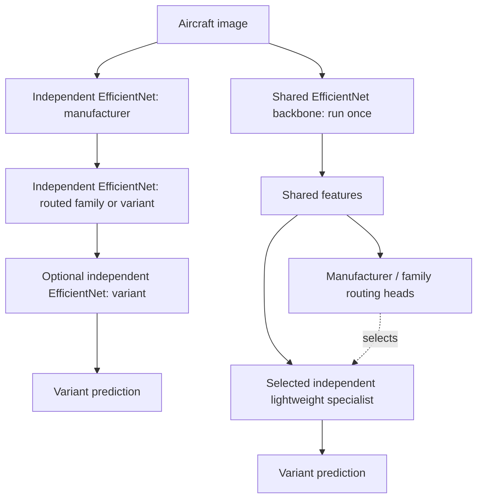

# cls-balance — Hierarchical vs. Shared-Backbone Aircraft Classification

A reproducible research project comparing **independent EfficientNet cascades** against a **single frozen EfficientNet with independently trainable specialist heads** on [FGVC-Aircraft](https://www.robots.ox.ac.uk/~vgg/data/fgvc-aircraft/).

> **Status:** Stage-one data preparation is implemented, with CPU tests and an operational CLI. Later model/training/benchmark phases remain planned. No models have been trained and no classification or latency results are claimed.

## Research question

**Can we preserve the accuracy and modular updates of specialist classifiers while avoiding repeated full-backbone inference?**

Compare the end-to-end classification of **aircraft variants** using the same images, hierarchy, inference hardware, and evaluation protocol.

### Architectures



The project studies **two-stage** (manufacturer → variant) and **three-stage** (manufacturer → family → variant) hierarchies. Single-class branches return their sole label directly.

### Comparison matrix

| ID | Backbone/heads | Routing | Purpose |
| --- | --- | --- | --- |
| FLAT | One fine-tuned EfficientNet, 100 variants | None | Non-hierarchical baseline |
| IND-2 | Independent EfficientNet per executed stage/branch | 2-stage hard | Existing method |
| IND-3 | Independent EfficientNet per executed stage/branch | 3-stage hard | Cost of deeper cascade |
| FROZEN-2 / FROZEN-3 | ImageNet-frozen EfficientNet + separately trained heads | 2-/3-stage hard | Frozen generic representation |
| FT-FROZEN-2 / FT-FROZEN-3 | Variant-fine-tuned, then frozen EfficientNet + separately trained heads | 2-/3-stage hard | Task-specific shared features |

The shared-backbone design computes visual features **once**. Specialist heads can then be retrained and replaced independently so long as the backbone and its preprocessing remain unchanged.

## Primary outcomes

- **Variant macro recall** (the benchmark's mean per-class accuracy).
- **Per-image p95 end-to-end inference latency**, batch size 1.

Supporting outcomes: variant top-1 accuracy and macro-F1; manufacturer/family accuracy; oracle-routing variant accuracy; routing errors; p50 latency, sustained FPS, MACs, peak GPU memory, total artifact size, training/update cost, and accuracy of unaffected classes after a specialist update.

**Never evaluate architecture A on different test images from architecture B.** Do not tune against the test set.

## Documents

- [Full experiment specification](docs/EXPERIMENT_PLAN.md) — dataset, hypotheses, methods, metrics, controls, statistics and risks.
- [Implementation roadmap](docs/ROADMAP.md) — proposed modules, phases, work packages, acceptance tests.
- [Results template](docs/RESULTS_TEMPLATE.md) — reporting layout for reproducible results.
- [Example experiment configuration](configs/benchmark.example.yaml) — proposed settings; not an executable pipeline.
- [AGENTS.md](AGENTS.md) — implementation guidance for coding agents.

## Dataset note

The current Torchvision `FGVCAircraft` loader documents **10,000 images, 100 variants, 70 families, and 30 manufacturers**, with official train/validation/test splits. The dataset's original website also describes a broader **10,200-image / 102-variant** release; **do not silently mix versions**. Record the loader version and inspect the generated class manifest. See [Torchvision source](https://github.com/pytorch/vision/blob/main/torchvision/datasets/fgvc_aircraft.py) and [official documentation](https://www.robots.ox.ac.uk/~vgg/data/fgvc-aircraft/).

FGVC-Aircraft is intended for non-commercial research; check terms before any commercial use.

## Getting started

Use Python 3.12. The following commands work in PowerShell; on Linux/macOS use `.venv/bin/python` in place of `.venv/Scripts/python.exe`.

```powershell
python -m venv .venv
.venv/Scripts/python.exe -m pip install -r requirements/cpu-py312.lock
.venv/Scripts/python.exe -m pip install -e ".[test]"
.venv/Scripts/python.exe -m pip check
.venv/Scripts/python.exe -m pytest -q
.venv/Scripts/python.exe -m cls_balance.prepare --config configs/data.yaml
```

The [CPU environment export](requirements/cpu-py312.lock) pins the complete validated dependency set. It is a Windows x64/Python 3.12 export; CPU CI on Ubuntu tests the pinned direct dependencies in `pyproject.toml`. GPU environments belong to a later training phase and must record their own CUDA build and environment export.

The last command downloads the official archive (about 2.75 GB) under ignored `data/`, validates all 10,000 images, and creates a unique ignored `runs/data/data-<UTC>-<random>/` directory. Allow disk space for both archive and extracted images. With an existing dataset, add `--no-download`. The installed `cls-balance-prepare` entry point accepts the same arguments. Paths in [configs/data.yaml](configs/data.yaml) resolve relative to that file; the broader `benchmark.example.yaml` remains a proposed schema.

Preparation joins all annotation levels by image ID, verifies the 3334/3333/3333 split sizes and 100/70/30 label counts, derives the taxonomy from training only, and checks validation/test paths against it. Canonical IDs sort training label names; they may differ from Torchvision IDs, so the adapter converts explicitly. Missing/corrupt images, split leakage and inconsistent hierarchy paths are errors. Every image is decoded and checksummed.

Archive provenance: the official 2,753,340,328-byte archive has MD5 `d4acdd33327262359767eeaa97a4f732`, matching the [independently archived MILA checksum](https://github.com/datasets-mila/datasets--fgvcaircraft/blob/master/md5sums). The [authors' checksum page](https://www.robots.ox.ac.uk/~vgg/data/fgvc-aircraft/archives/fgvc-aircraft-2013b.html) instead lists `32eca553f897e747706144f3bb444df0`; the cause is unknown. Preparation enforces the independently recorded checksum when an archive is present and preserves this discrepancy in run metadata. An existing extracted dataset without an archive is identified explicitly and still undergoes all image/annotation checks.

Each completed data run contains split CSV manifests, a taxonomy with global/local maps, source annotation checksums, per-image checksums, preprocessing and environment JSON, resolved configuration, and `summary.json`. A failed run has no summary and must not be treated as validated. `spot_checks.jpg` contains six training-image pairs for local geometry review. Images, manifests, archives and run directories remain local. Publish only aggregate validation reports under `results/`; no samples, labels-by-image, embeddings or weights go into Git.

The primary transform removes the bottom 20 pixels, resizes all remaining content with bicubic interpolation and centered black padding to 224×224, then applies the `EfficientNet_B0_Weights.IMAGENET1K_V1` mean/std. No weights download is needed. Validation/test transforms have no augmentation. Training uses a flip and brightness/contrast jitter, seeded by `(seed, epoch, image_id)`. Call `AircraftDataset.set_epoch(epoch)` before creating each DataLoader iterator and use `persistent_workers=False` to propagate epoch changes to workers. Tests exercise two worker processes and shuffled order.

Follow the [roadmap](docs/ROADMAP.md) for the next phase. Training, evaluation and benchmarking commands in that document are still **planned**, and are not operational yet.

## Scope

The current implementation covers data preparation and its reproducibility prerequisites. Checkpoints and raw datasets stay outside Git; future model results must follow [RESULTS_TEMPLATE.md](docs/RESULTS_TEMPLATE.md).
