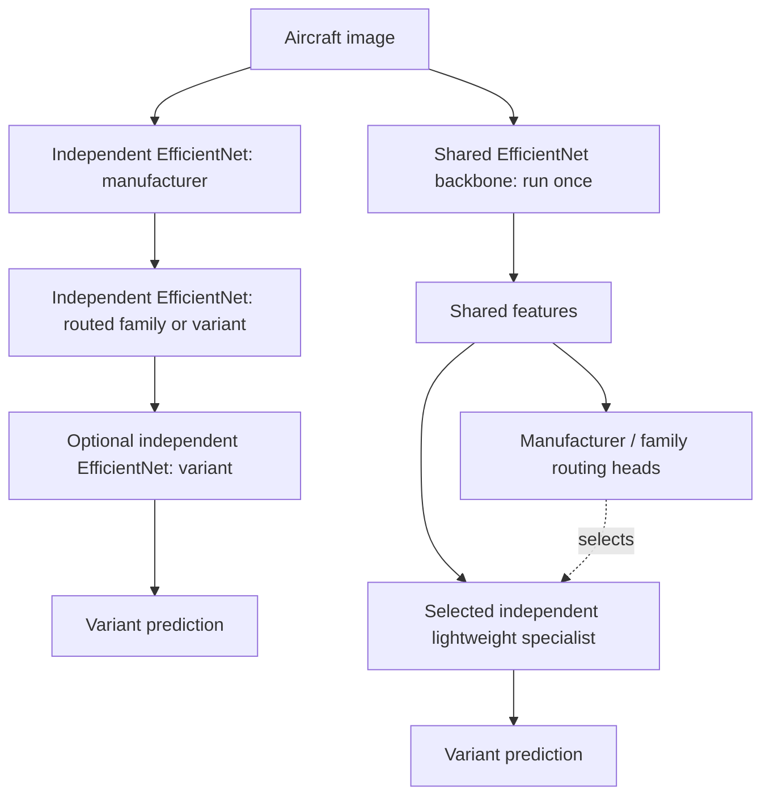

# cls-balance — Hierarchical vs. Shared-Backbone Aircraft Classification

A reproducible research project comparing **independent EfficientNet cascades** against a **single frozen EfficientNet with independently trainable specialist heads** on [FGVC-Aircraft](https://www.robots.ox.ac.uk/~vgg/data/fgvc-aircraft/).

> **Status:** Phases 0–8 are implemented. On all 3,333 official test images, three-seed variant macro recall is **FLAT 65.59% ± 0.37 pp**, **IND-2 53.51% ± 1.02 pp**, **FT-FROZEN-2 63.02% ± 0.93 pp** (sample SD). Mean seed-p95 full-pipeline latency is **32.47 / 57.15 / 34.26 ms**, respectively, from five batch-one FP32 passes per checkpoint. The shared cascade has **40.05% lower p95** than IND-2 on this hardware. See the [consolidated results with per-seed bootstrap intervals and update tradeoffs](docs/RESULTS.md) and the [measured Phase 6 report, graphs and full networks](results/stage6/benchmark-20261028T022812Z-fa52c222/REPORT.md). The [Phase 7 introduction experiment](results/stage7/incremental-20261029T102022Z-dd4acc20/REPORT.md) now measures isolated specialist replacement from fresh 99-class initial systems across all three seeds. Generic ImageNet-frozen, three-stage and FP16 experimental measurements remain separate unmeasured work.

Phase two has **172 passing CPU tests**, with the suite frozen after validation.
See the [phase-two validation report](results/stage2/validation-20261025T024200Z-cc4d2a5a/REPORT.md)
for test output, official-data preflight and reproducibility evidence.

Phase three adds **31 checks**, for **203 passing tests** in total. The original
frozen suite is unchanged. See the [phase-three validation and export audit](results/stage3/validation-20261025T042101Z-bcc17404/REPORT.md).

## Research question

**Can we preserve the accuracy and modular updates of specialist classifiers while avoiding repeated full-backbone inference?**

Compare the end-to-end classification of **aircraft variants** using the same images, hierarchy, inference hardware, and evaluation protocol.

### Architectures



The project studies **two-stage** (manufacturer → variant) and **three-stage** (manufacturer → family → variant) hierarchies. Single-class branches return their sole label directly.

### Comparison matrix

| ID | Backbone/heads | Routing | Purpose |
| --- | --- | --- | --- |
| FLAT | One fine-tuned EfficientNet, 100 variants | None | Non-hierarchical baseline |
| IND-2 | Independent EfficientNet per executed stage/branch | 2-stage hard | Existing method |
| IND-3 | Independent EfficientNet per executed stage/branch | 3-stage hard | Cost of deeper cascade |
| FROZEN-2 / FROZEN-3 | ImageNet-frozen EfficientNet + separately trained heads | 2-/3-stage hard | Frozen generic representation |
| FT-FROZEN-2 / FT-FROZEN-3 | Variant-fine-tuned, then frozen EfficientNet + separately trained heads | 2-/3-stage hard | Task-specific shared features |

The shared-backbone design computes visual features **once**. Specialist heads can then be retrained and replaced independently so long as the backbone and its preprocessing remain unchanged.

## Primary outcomes

- **Variant macro recall** (the benchmark's mean per-class accuracy).
- **Per-image p95 end-to-end inference latency**, batch size 1.

Supporting outcomes: variant top-1 accuracy and macro-F1; manufacturer/family accuracy; oracle-routing variant accuracy; routing errors; p50 latency, sustained FPS, MACs, peak GPU memory, total artifact size, training/update cost, and accuracy of unaffected classes after a specialist update.

**Never evaluate architecture A on different test images from architecture B.** Do not tune against the test set.

## Documents

- [Full experiment specification](docs/EXPERIMENT_PLAN.md) — dataset, hypotheses, methods, metrics, controls, statistics and risks.
- [Implementation roadmap](docs/ROADMAP.md) — proposed modules, phases, work packages, acceptance tests.
- [Results template](docs/RESULTS_TEMPLATE.md) — reporting layout for reproducible results.
- [Consolidated measured results](docs/RESULTS.md) — paired per-seed intervals, all primary endpoints, routing/path analysis and update tradeoffs.
- [Phase-eight analysis and publication](docs/PHASE8.md) — frozen evidence, statistical methods, figure regeneration and audit contracts.
- [Phase-two API and test freeze](docs/PHASE2.md) — operational adapters, evaluation, saved-run audit and frozen test policy.
- [Phase-three training and review](docs/PHASE3.md) — operational CUDA setup, FLAT training, encoder export, diagrams and report generation.
- [Phase-four independent cascades](docs/PHASE4.md) — full CNN node training, predicted/oracle validation, residency policies and review plots.
- [Phase-five shared frozen heads](docs/PHASE5.md) — independent MLP fitting, encoder/cache checks, specialist replacement and validation review.
- [Phase-six benchmark and review](docs/PHASE6.md) — synchronized full-test timings, throughput, resources, publication audits and complete network schematics.
- [Phase-seven class introduction](docs/PHASE7.md) — 99-class initial systems, isolated specialist replacement, test review and full before/after networks.
- [Operational benchmark configuration](configs/benchmark.yaml) — fixed selected checkpoints, all test images and five FP32 passes.
- [Example experiment configuration](configs/benchmark.example.yaml) — broader proposed schema; not an executable pipeline.
- [AGENTS.md](AGENTS.md) — implementation guidance for coding agents.

## Dataset note

The current Torchvision `FGVCAircraft` loader documents **10,000 images, 100 variants, 70 families, and 30 manufacturers**, with official train/validation/test splits. The dataset's original website also describes a broader **10,200-image / 102-variant** release; **do not silently mix versions**. Record the loader version and inspect the generated class manifest. See [Torchvision source](https://github.com/pytorch/vision/blob/main/torchvision/datasets/fgvc_aircraft.py) and [official documentation](https://www.robots.ox.ac.uk/~vgg/data/fgvc-aircraft/).

FGVC-Aircraft is intended for non-commercial research; check terms before any commercial use.

## Getting started

Use Python 3.12. The following commands work in PowerShell; on Linux/macOS use `.venv/bin/python` in place of `.venv/Scripts/python.exe`.

```powershell
python -m venv .venv
.venv/Scripts/python.exe -m pip install -r requirements/cpu-py312.lock
.venv/Scripts/python.exe -m pip install -e ".[test]"
.venv/Scripts/python.exe -m pip check
.venv/Scripts/python.exe scripts/freeze_tests.py --check
.venv/Scripts/python.exe -m pytest -q
.venv/Scripts/python.exe -m cls_balance.prepare --config configs/data.yaml
```

The [CPU environment export](requirements/cpu-py312.lock) pins the complete validated dependency set. It is a Windows x64/Python 3.12 export; CPU CI on Ubuntu tests the pinned direct dependencies in `pyproject.toml`. Phase 3 has a separate [CUDA 12.8 training environment export](requirements/cuda-py312.lock), validated on an RTX 3060 Laptop GPU.

The last command downloads the official archive (about 2.75 GB) under ignored `data/`, validates all 10,000 images, and creates a unique ignored `runs/data/data-<UTC>-<random>/` directory. Allow disk space for both archive and extracted images. With an existing dataset, add `--no-download`. The installed `cls-balance-prepare` entry point accepts the same arguments. Paths in [configs/data.yaml](configs/data.yaml) resolve relative to that file; the broader `benchmark.example.yaml` remains a proposed schema.

Preparation joins all annotation levels by image ID, verifies the 3334/3333/3333 split sizes and 100/70/30 label counts, derives the taxonomy from training only, and checks validation/test paths against it. Canonical IDs sort training label names; they may differ from Torchvision IDs, so the adapter converts explicitly. Missing/corrupt images, split leakage and inconsistent hierarchy paths are errors. Every image is decoded and checksummed.

Archive provenance: the official 2,753,340,328-byte archive has MD5 `d4acdd33327262359767eeaa97a4f732`, matching the [independently archived MILA checksum](https://github.com/datasets-mila/datasets--fgvcaircraft/blob/master/md5sums). The [authors' checksum page](https://www.robots.ox.ac.uk/~vgg/data/fgvc-aircraft/archives/fgvc-aircraft-2013b.html) instead lists `32eca553f897e747706144f3bb444df0`; the cause is unknown. Preparation enforces the independently recorded checksum when an archive is present and preserves this discrepancy in run metadata. An existing extracted dataset without an archive is identified explicitly and still undergoes all image/annotation checks.

Each completed data run contains split CSV manifests, a taxonomy with global/local maps, source annotation checksums, per-image checksums, preprocessing and environment JSON, resolved configuration, and `summary.json`. A failed run has no summary and must not be treated as validated. `spot_checks.jpg` contains six training-image pairs for local geometry review. Images, manifests, archives and run directories remain local. Data-preparation publications contain aggregate audits. Phase-three publications additionally contain validation predictions and aggregate training metrics; no aircraft images, training-image ID lists, embeddings or weights go into Git.

The primary transform removes the bottom 20 pixels, resizes all remaining content with bicubic interpolation and centered black padding to 224×224, then applies the `EfficientNet_B0_Weights.IMAGENET1K_V1` mean/std. No weights download is needed. Validation/test transforms have no augmentation. Training uses a flip and brightness/contrast jitter, seeded by `(seed, epoch, image_id)`. Call `AircraftDataset.set_epoch(epoch)` before creating each DataLoader iterator and use `persistent_workers=False` to propagate epoch changes to workers. Tests exercise two worker processes and shuffled order.

The [phase-two API](docs/PHASE2.md) wraps supplied classifier modules for FLAT,
independent cascades and shared frozen models. It implements global-ID hard/oracle
routing, singleton bypasses, full-split metrics, per-image CSVs and immutable run
metadata. Audit a saved evaluation with
`python -m cls_balance.evaluate --run-dir <existing-eval-run-directory>`.
FLAT training, independent hierarchical training, shared frozen-head training
and the common full-test benchmark are operational.

## Train and review FLAT

Keep the validated CPU environment and create a separate GPU environment:

```powershell
.venv/Scripts/python.exe -m venv .venv-cuda
.venv-cuda/Scripts/python.exe -m pip install -r requirements/cuda-py312.lock
.venv-cuda/Scripts/python.exe -m pip install -e '.[test]'
.venv-cuda/Scripts/python.exe -m pip check
.venv-cuda/Scripts/python.exe -m cls_balance.train --config configs/flat.yaml
.venv/Scripts/python.exe -m pytest -q tests checks
```

Set `prepared_run` in [configs/flat.yaml](configs/flat.yaml) to your completed
Phase 1 preparation run; all paths resolve relative to the YAML. The command
verifies every image against that preparation, then trains all three seeds in
FP32 with AdamW, a 30-epoch cap and validation-only early stopping (patience 7).
There is no test inference. Selected epochs were 17/23/26; completed epochs were
24/30/30. Each run contains full and frozen encoder-only checkpoints, exact reload
checks, configurations, environment/source hashes, histories, resource accounting,
and audited complete train/validation predictions. Interrupted runs must restart;
resume is not implemented.

Generate a new immutable review bundle from completed local run directories:

```powershell
.venv-cuda/Scripts/python.exe -m cls_balance.report_flat --runs runs/flat/flat-s42-20261025T031340Z-5385e556 runs/flat/flat-s43-20261025T034152Z-d43e9130 runs/flat/flat-s44-20261025T041556Z-40c093b2 --output-root results/stage3
```

Those are the measured runs in this workspace; substitute the new IDs printed by
your training command. The [report](results/stage3/flat-20261025T045223Z-788dc5f4/REPORT.md)
includes learning/loss curves, validation confusion matrices, per-class recall and
generalization figures. SVGs use LF line endings so their hashes survive Git
checkouts. [PHASE3.md](docs/PHASE3.md) explains the artifact flow and audit contracts.

## Train and review independent cascades

```powershell
& .\.venv-cuda\Scripts\python.exe -m cls_balance.train_independent --config configs/independent.yaml
& .\.venv\Scripts\python.exe scripts/freeze_tests.py --check
& .\.venv\Scripts\python.exe -m pytest -q tests checks
```

Set `prepared_run` to the completed preparation directory. The default trains
IND-2 for seeds 42/43/44: a full manufacturer CNN and 17 full variant-specialist
CNNs, each with independent weights and validation selection. Singleton branches
are deterministic. Complete predicted-route and oracle diagnostics use all 3,333
validation images; test inference is deferred. Checkpoints, images and node
contracts containing training IDs stay in ignored local runs.

IND-3 is also runnable with `depths: [3]` (or `[2, 3]` for both), using 33 full
CNNs. Its measurement remains an opt-in ablation after the two-stage shared
comparison and common benchmark, following the execution order. See
[PHASE4.md](docs/PHASE4.md) for exact retry/audit contracts and policy definitions.

```powershell
& .\.venv-cuda\Scripts\python.exe -m cls_balance.report_independent --runs runs/independent/ind-s42-20261026T125759Z-6d87251e runs/independent/ind-s43-20261026T141824Z-b8c12b2c runs/independent/ind-s44-20261026T153237Z-2b462c75 --output-root results/stage4
& .\.venv-cuda\Scripts\python.exe -m cls_balance.residency --run runs/independent/ind-s42-20261026T125759Z-6d87251e --depth 2 --device cuda:0
```

Those are the measured local runs; substitute IDs printed by a new training run.
Reports include
audited validation predictions, local specialist scores/exposures/hashes,
learning/loss curves, routing penalties, singleton execution paths and confusion
matrices. Residency supports all models on device, CPU-preloaded transfer on
demand, and disk loading on demand. The residency command measures synchronized,
un-warmed validation probes from ready tensors; it is separate from the
Phase 6 full-pipeline test benchmark and does not establish p95/FPS claims.

The [three-seed report](results/stage4/independent-20261027T071605Z-64675e2e/REPORT.md)
records **56.13% ± 1.17 pp** validation variant macro recall (sample SD), from
54 independently fitted CNNs with exact reload checks. It includes the complete
validation predictions, learning/loss and specialist curves, routing penalties,
confusion matrices, class recalls and an explanatory architecture diagram.
The [validation evidence](results/stage4/validation-20261027T071705Z-2b712381/REPORT.md)
contains the regression checks, measured residency probes and discarded-attempt
records, including a user pause and a system sleep that required node retries.
Training data and weights remain local. The separate Phase 6 runs now retain
official test predictions and full-pipeline latency/FPS measurements.

## Train and review shared frozen heads

```powershell
& .\.venv-cuda\Scripts\python.exe -m cls_balance.train_shared --config configs/shared.yaml
& .\.venv\Scripts\python.exe scripts/freeze_tests.py --check
& .\.venv\Scripts\python.exe -m pytest -q tests checks
& .\.venv-cuda\Scripts\python.exe -m cls_balance.report_shared --runs <seed42-run> <seed43-run> <seed44-run> --output-root results/stage5
```

Set preparation and matching FLAT paths in [shared.yaml](configs/shared.yaml).
Replace report placeholders with the immutable run directories printed by training.
The default fits 18 separate MLPs per seed on one frozen task-adapted EfficientNet:
manufacturer router plus 17 multi-variant manufacturer heads. Fresh augmented
features are computed once per training image per epoch, then used read-only by
each independent head optimizer. Each head selects its own checkpoint with local
validation macro recall; singleton branches have no classifier. Complete final
predicted/oracle evaluations use the real image path on all validation images.

Both encoder weights and BatchNorm buffers remain fixed. Exports must reproduce
embeddings/logits exactly. `cache_root` optionally persists separately versioned
training-only augmented views; the default uses memory. Compatible head overrides
can replace one specialist without changing unrelated head weights/logits.
[PHASE5.md](docs/PHASE5.md) documents exact contracts and the Python replacement API.

The same commands support `backbone: FROZEN` and `depths: [2, 3]` in a separate
configuration. These generic/depth measurements remain opt-in after the primary
two-stage benchmark. Reports accept both backbone types with matching seed sets
and depths. Optional `--flat-runs` and `--independent-runs` add audited paired
validation comparisons. Checkpoints, caches, images and training-ID lists stay
local; validation predictions, aggregate histories and SVG figures can be committed.

On Windows, `python scripts/train_shared_awake.py --config configs/shared.yaml`
invokes the same training with a temporary process-lifetime idle-sleep request.
The request releases on exit and does not alter the power plan or GPU clocks.

The [measured Phase 5 report](results/stage5/shared-20261027T145809Z-ee48fbad/REPORT.md)
contains all three seeds, complete predicted/oracle validation predictions,
every head's learning/loss curves, confusion matrices, per-class recall, error
attribution, source FLAT training cost and stored artifact footprint. FT-FROZEN-2
achieved **63.43% ± 0.25 pp** validation macro recall; the complete predicted
pipeline remains below its oracle diagnostic, and the report exposes the
training/validation generalization gap. All 54 selected heads reloaded exactly;
all three encoder parameter/buffer hashes remained unchanged. Phase 5 adds 22
checks, bringing the complete CPU suite to **235 passing tests**.
The [Phase 5 validation evidence](results/stage5/validation-20261027T150049Z-777f9bfa/REPORT.md)
contains full/subset test logs, focused CUDA checks, the actual training log,
source hashes and independent publication audits. No training images, image-ID
lists, embeddings or weights are included in these publications.

## Benchmark and review the selected networks

The [measured report and full diagrams](results/stage6/benchmark-20261028T022812Z-fa52c222/REPORT.md)
retain 149,985 timings and all test predictions. [Validation evidence](results/stage6/validation-20261028T023745Z-a38164e6/REPORT.md)
includes **270 passing CPU tests (one CUDA-only skip)**, **36 passing CUDA checks**,
the unchanged original test freeze, post-benchmark checksums for all 10,000 images,
and a verified rebuild from published results without data or checkpoints.

```powershell
.venv-cuda/Scripts/python.exe -m cls_balance.benchmark --config configs/benchmark.yaml
.venv-cuda/Scripts/python.exe -m cls_balance.report_benchmark --suite <completed-suite-directory> --output-root results/stage6 --preview-root .tmp/phase6-previews
.venv-cuda/Scripts/python.exe -m cls_balance.report_benchmark --audit <published-review-directory>
# Regenerate graphs from committed results without dataset images or weights:
.venv-cuda/Scripts/python.exe -m cls_balance.report_benchmark --rebuild <published-review-directory> --output-root .tmp/rebuilt-phase6
```

The [operational YAML](configs/benchmark.yaml) selects the existing three-seed
FLAT, IND-2 and FT-FROZEN-2 checkpoints. Every invocation creates an immutable
suite after auditing all selected checkpoints and official dataset checksums.
All 3,333 test images receive five timed batch-one FP32 passes with synchronized
file-decode/preprocessing/transfer/predicted-route/global-ID boundaries. Separate
nested model-path latency, observed elapsed-time FPS, every executed branch,
singleton rates, conditional Conv2d/Linear MACs, all-model storage and GPU peaks
are retained. Oracle diagnostics run separately, outside timing. Run regression
tests before or after timing to avoid CPU workload interference.

Publications include accuracy/latency, pass distributions, routing errors,
confusion matrices, every specialist's training/validation curves, complete
network diagrams expanding all 17 specialists and 13 singleton branches, and
detailed EfficientNet/MLP internals. Checkpoint tensors, training IDs, images and
embedding caches stay local. See [PHASE6.md](docs/PHASE6.md) for audit contracts,
the optional separate FP16 invocation, limitations and reporting definitions.

## Introduce one variant and review the update

Phase 7 trains fresh 99-class initial systems with
[incremental.yaml](configs/incremental.yaml). Its training-only deterministic
rule selects **Boeing 737-200 (global ID 2)** while retaining both its manufacturer
and its existing family. All of this class's initial train **and validation**
images are withheld from every initial model, including FLAT backbone tuning.
The 100-class encoders from the earlier phases are ineligible for this experiment.

```powershell
.venv-cuda/Scripts/python.exe scripts/train_incremental_awake.py train --config configs/incremental.yaml
.venv-cuda/Scripts/python.exe scripts/train_incremental_awake.py evaluate --suite <completed-training-suite>
.venv-cuda/Scripts/python.exe -m cls_balance.report_incremental --training <completed-training-suite> --evaluation <completed-evaluation-suite> --output-root results/stage7 --preview-root .tmp/phase7-previews
.venv-cuda/Scripts/python.exe -m cls_balance.report_incremental --audit <published-review>
# Regenerate every report figure using only published evidence:
.venv-cuda/Scripts/python.exe -m cls_balance.report_incremental --rebuild <published-review> --rebuild-output .tmp/rebuilt-phase7
```

Training completes all three seeds before any test inference. Introduction adds
the new class's training examples and replays the existing branch examples; only
the affected full CNN or shared MLP is retrained. Existing output rows are warm
started, the new row is seeded, and validation alone selects the replacement.
Manufacturer routers, the shared encoder and every unrelated specialist retain
their exact parameters. Original affected specialists remain available to audit
the before/after comparison.

Every predicted/oracle before/after evaluation retains all 3,333 official test
images. Reports distinguish 99-class initial accuracy from the retrospective
all-100 diagnostic, and measure new-class recall, old-branch performance,
outside-branch accuracy, update duration, trainable parameters and replacement
size. They include complete test predictions, learning curves, all class recalls,
and five full network schematics with every trained specialist, deterministic
bypass and per-seed selected epoch. Exact training/inference sources are archived
alongside their hashes; dataset images, training IDs, embeddings and weights stay
local. [PHASE7.md](docs/PHASE7.md) explains timing boundaries, resuming and audits.

The [measured Phase 7 report](results/stage7/incremental-20261029T102022Z-dd4acc20/REPORT.md)
contains 79,992 test predictions, 11 SVG figures and five complete before/after
network schematics. Values below are means across seeds 42/43/44; where shown,
± denotes sample SD:

| Incremental outcome | IND-2 | FT-FROZEN-2 |
| --- | --- | --- |
| Introduced 737-200 recall (%) | 54.90 ± 13.90 | 58.82 ± 10.60 |
| Existing Boeing variants, before → after macro recall (%) | 36.04 → 35.67 | 46.68 → 43.20 |
| Outside-branch macro recall, before → after (%) | 58.20 → 58.20 | 65.97 → 65.97 |
| Specialist update duration (s) | 375.96 ± 110.42 | 192.89 ± 35.50 |
| Replacement checkpoint (decimal MB) | 16.45 | 1.36 |

The shared update is cheaper in this experiment, with a larger drop in recall on
the updated branch's existing classes. Outside-branch accuracy is measured to be
unchanged; incorrectly routed outside images can still change their wrong label.
The audit verifies 120 checkpoints, exact untouched-module logits, unchanged
encoder weights/buffers and no introduced-class leakage into initial fitting.
Update duration includes shared feature extraction and is separate from inference
latency. Initial encoder training costs are included separately in the report.
The [Phase 7 validation evidence](results/stage7/validation-20261029T103720Z-f75088da/REPORT.md)
contains **305 passing CPU tests (three explicit skips)**, **73 passing CUDA checks**,
the unchanged original test freeze, post-experiment checksums for all 10,000 images,
and an artifact-only rebuild preserving all 432 report files byte for byte.

## Scope

The current implementation covers Phases 0–8. Generic frozen and three-stage
experimental measurements remain separate pending ablations. The original validated
test suite is frozen with SHA256 checks enforced in CI; Phase 3/4/5 checks run in
their CI workflows; Phase 6 adds benchmark/publication checks and Phase 7 adds
class-introduction and artifact-only review checks. Phase 8 adds paired per-seed
statistics, consolidated results and reproducible publication checks.
Checkpoints and raw datasets stay outside Git; model results follow
[RESULTS_TEMPLATE.md](docs/RESULTS_TEMPLATE.md).

## Reproduce the complete study

The consolidated findings are in [docs/RESULTS.md](docs/RESULTS.md); the statistical
and artifact contracts are in [PHASE8.md](docs/PHASE8.md). To regenerate the final
tables and new figures from committed test evidence, no dataset or weights are
needed:

```powershell
python -m venv .venv-review
.venv-review/Scripts/python.exe -m pip install -r requirements/cpu-py312.lock
.venv-review/Scripts/python.exe -m pip install -e '.[test]' -r requirements/phase3-plots.txt
.venv-review/Scripts/python.exe -m cls_balance.report_analysis --config configs/analysis.yaml --preview-root .tmp/phase8-previews
# Also regenerate all linked learning curves, full networks and update plots:
.venv-review/Scripts/python.exe -m cls_balance.report_benchmark --rebuild results/stage6/benchmark-20261028T022812Z-fa52c222 --output-root .tmp/rebuilt-phase6
.venv-review/Scripts/python.exe -m cls_balance.report_incremental --rebuild results/stage7/incremental-20261029T102022Z-dd4acc20 --rebuild-output .tmp/rebuilt-phase7
```

This prints a new immutable review directory. Audit it with `--audit <directory>`;
rebuild all its bytes with `--rebuild <directory> --output .tmp/rebuilt-phase8`.
Add `--results-doc docs/RESULTS.md` when explicitly updating the consolidated
documentation from a new publication; this rebases all report/figure links.
The report links the existing Phase 6/7 figures; their `--rebuild` commands above
regenerate the complete learning curves, network diagrams and update plots.

To reproduce the **training and test measurements** from scratch, use Python 3.12
and compatible NVIDIA hardware, obtain the dataset under its non-commercial
research terms, and run the following sequence from the repository root. These
are operational commands. Paths in each YAML resolve relative to that YAML.
After each stage, use the new immutable IDs it prints in the downstream YAML;
the checked-in paths identify the original measured runs and cannot refer to a
fresh checkout's uncommitted data or weights. Keep all non-path settings frozen.

```powershell
python -m venv .venv-cuda
.venv-cuda/Scripts/python.exe -m pip install -r requirements/cuda-py312.lock
.venv-cuda/Scripts/python.exe -m pip install -e '.[test]' -r requirements/phase3-plots.txt
.venv-cuda/Scripts/python.exe -m pip check
# Downloads and checks the official archive; --no-download uses existing data.
.venv-cuda/Scripts/python.exe -m cls_balance.prepare --config configs/data.yaml
# Set prepared_run in flat/independent/shared/benchmark/incremental YAMLs.
.venv-cuda/Scripts/python.exe -m cls_balance.train --config configs/flat.yaml
.venv-cuda/Scripts/python.exe -m cls_balance.train_independent --config configs/independent.yaml
# Set shared.yaml flat_runs to the new seed-matched FLAT directories.
.venv-cuda/Scripts/python.exe scripts/train_shared_awake.py --config configs/shared.yaml
# Set benchmark.yaml runs to the nine new runs, retaining the rotated order.
.venv-cuda/Scripts/python.exe -m cls_balance.benchmark --config configs/benchmark.yaml
.venv-cuda/Scripts/python.exe -m cls_balance.report_benchmark --suite <new-benchmark-suite> --output-root results/stage6
# Fresh reduced-label systems; earlier 100-class encoders are ineligible.
.venv-cuda/Scripts/python.exe scripts/train_incremental_awake.py train --config configs/incremental.yaml
.venv-cuda/Scripts/python.exe scripts/train_incremental_awake.py evaluate --suite <new-incremental-training-suite>
.venv-cuda/Scripts/python.exe -m cls_balance.report_incremental --training <new-incremental-training-suite> --evaluation <new-incremental-evaluation-suite> --output-root results/stage7
# Copy analysis.yaml; bind the NEW publications and their manifest SHA256s.
.venv-cuda/Scripts/python.exe -m cls_balance.report_analysis --config <new-analysis.yaml>
.venv-cuda/Scripts/python.exe scripts/freeze_tests.py --check
.venv-cuda/Scripts/python.exe -m pytest -q tests checks
```

The benchmark evaluates all test images only after checkpoint selection is
frozen. Its suite contains per-image predictions/timings, oracle diagnostics and
resources. Phase 7 evaluates test data only after all initial and replacement
fits complete. Source publications preserve seeds, configurations, environment,
source/checkpoint hashes, training budgets and failures. The final analysis
checks full source inventories and recomputes every numeric result before
publishing. Other hardware can reproduce the protocol; its measured latency
need not equal this laptop's results.
