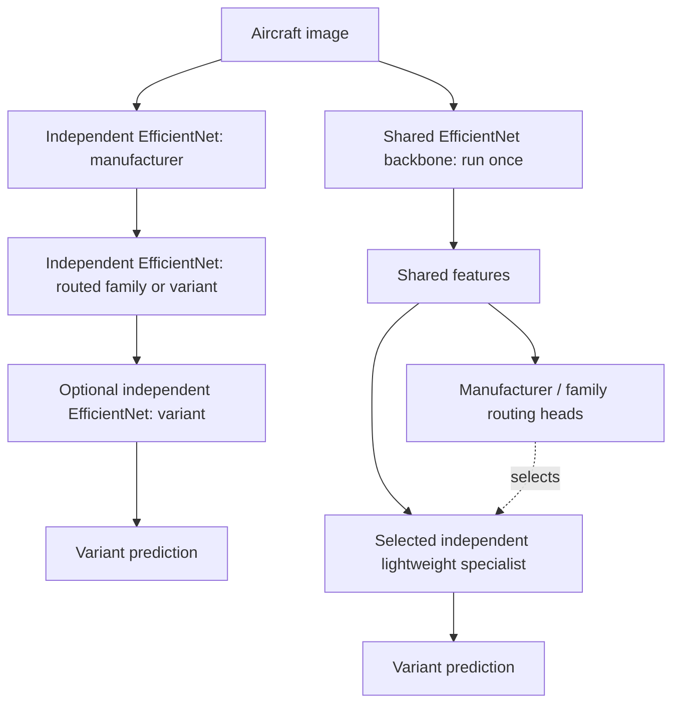

# cls-balance — Hierarchical vs. Shared-Backbone Aircraft Classification

A reproducible research project comparing **independent EfficientNet cascades** against a **single frozen EfficientNet with independently trainable specialist heads** on [FGVC-Aircraft](https://www.robots.ox.ac.uk/~vgg/data/fgvc-aircraft/).

> **Status:** Experiment design and implementation plan. No models have been trained, and no benchmark results are claimed yet.

## Research question

**Can we preserve the accuracy and modular updates of specialist classifiers while avoiding repeated full-backbone inference?**

Compare the end-to-end classification of **aircraft variants** using the same images, hierarchy, inference hardware, and evaluation protocol.

### Architectures

The project studies **two-stage** (manufacturer → variant) and **three-stage** (manufacturer → family → variant) hierarchies. Single-class branches return their sole label directly.

### Comparison matrix

| ID | Backbone/heads | Routing | Purpose |
| --- | --- | --- | --- |
| FLAT | One fine-tuned EfficientNet, 100 variants | None | Non-hierarchical baseline |
| IND-2 | Independent EfficientNet per executed stage/branch | 2-stage hard | Existing method |
| IND-3 | Independent EfficientNet per executed stage/branch | 3-stage hard | Cost of deeper cascade |
| FROZEN-2 / FROZEN-3 | ImageNet-frozen EfficientNet + separately trained heads | 2-/3-stage hard | Frozen generic representation |
| FT-FROZEN-2 / FT-FROZEN-3 | Variant-fine-tuned, then frozen EfficientNet + separately trained heads | 2-/3-stage hard | Task-specific shared features |

The shared-backbone design computes visual features **once**. Specialist heads can then be retrained and replaced independently so long as the backbone and its preprocessing remain unchanged.

## Primary outcomes

- **Variant macro recall** (the benchmark's mean per-class accuracy).
- **Per-image p95 end-to-end inference latency**, batch size 1.

Supporting outcomes: variant top-1 accuracy and macro-F1; manufacturer/family accuracy; oracle-routing variant accuracy; routing errors; p50 latency, sustained FPS, MACs, peak GPU memory, total artifact size, training/update cost, and accuracy of unaffected classes after a specialist update.

**Never evaluate architecture A on different test images from architecture B.** Do not tune against the test set.

## Documents

- [Full experiment specification](docs/EXPERIMENT_PLAN.md) — dataset, hypotheses, methods, metrics, controls, statistics and risks.
- [Implementation roadmap](docs/ROADMAP.md) — proposed modules, phases, work packages, acceptance tests.
- [Results template](docs/RESULTS_TEMPLATE.md) — reporting layout for reproducible results.
- [Example experiment configuration](configs/benchmark.example.yaml) — proposed settings; not an executable pipeline.
- [AGENTS.md](AGENTS.md) — implementation guidance for coding agents.

## Dataset note

The current Torchvision `FGVCAircraft` loader documents **10,000 images, 100 variants, 70 families, and 30 manufacturers**, with official train/validation/test splits. The dataset's original website also describes a broader **10,200-image / 102-variant** release; **do not silently mix versions**. Record the loader version and inspect the generated class manifest. See [Torchvision source](https://github.com/pytorch/vision/blob/main/torchvision/datasets/fgvc_aircraft.py) and [official documentation](https://www.robots.ox.ac.uk/~vgg/data/fgvc-aircraft/).

FGVC-Aircraft is intended for non-commercial research; check terms before any commercial use.

## Getting started

Start with the [implementation roadmap](docs/ROADMAP.md). First implement dataset manifests and a single-model `FLAT` baseline. The remaining architectures should share the exact same metrics and inference harness. No training CLI has been implemented yet.

## Scope

This repository is a **design-first experiment**. Plans and empty results templates are committed first; checkpoints, raw datasets, and fabricated benchmark figures are not.