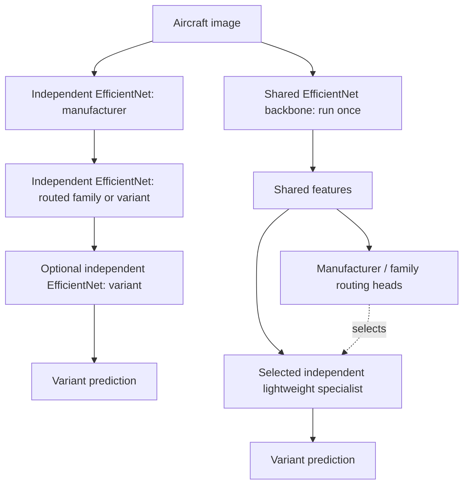

# cls-balance — Hierarchical vs. Shared-Backbone Aircraft Classification

A reproducible research project comparing **independent EfficientNet cascades** against a **single frozen EfficientNet with independently trainable specialist heads** on [FGVC-Aircraft](https://www.robots.ox.ac.uk/~vgg/data/fgvc-aircraft/).

> **Status:** Phases 0–3 are implemented. FLAT EfficientNet-B0 was trained on the complete official training split for seeds 42/43/44, with validation macro recall **65.58% ± 0.10 pp** (sample standard deviation). See the [measured report and graphs](results/stage3/flat-20261025T045223Z-788dc5f4/REPORT.md). Test inference and architectural/latency comparisons remain deferred. All three selected checkpoints achieved 100% deterministic training recall, so the report explicitly shows the generalization gap.

Phase two has **172 passing CPU tests**, with the suite frozen after validation.
See the [phase-two validation report](results/stage2/validation-20261025T024200Z-cc4d2a5a/REPORT.md)
for test output, official-data preflight and reproducibility evidence.

Phase three adds **31 checks**, for **203 passing tests** in total. The original
frozen suite is unchanged. See the [phase-three validation and export audit](results/stage3/validation-20261025T042101Z-bcc17404/REPORT.md).

## Research question

**Can we preserve the accuracy and modular updates of specialist classifiers while avoiding repeated full-backbone inference?**

Compare the end-to-end classification of **aircraft variants** using the same images, hierarchy, inference hardware, and evaluation protocol.

### Architectures



The project studies **two-stage** (manufacturer → variant) and **three-stage** (manufacturer → family → variant) hierarchies. Single-class branches return their sole label directly.

### Comparison matrix

| ID | Backbone/heads | Routing | Purpose |
| --- | --- | --- | --- |
| FLAT | One fine-tuned EfficientNet, 100 variants | None | Non-hierarchical baseline |
| IND-2 | Independent EfficientNet per executed stage/branch | 2-stage hard | Existing method |
| IND-3 | Independent EfficientNet per executed stage/branch | 3-stage hard | Cost of deeper cascade |
| FROZEN-2 / FROZEN-3 | ImageNet-frozen EfficientNet + separately trained heads | 2-/3-stage hard | Frozen generic representation |
| FT-FROZEN-2 / FT-FROZEN-3 | Variant-fine-tuned, then frozen EfficientNet + separately trained heads | 2-/3-stage hard | Task-specific shared features |

The shared-backbone design computes visual features **once**. Specialist heads can then be retrained and replaced independently so long as the backbone and its preprocessing remain unchanged.

## Primary outcomes

- **Variant macro recall** (the benchmark's mean per-class accuracy).
- **Per-image p95 end-to-end inference latency**, batch size 1.

Supporting outcomes: variant top-1 accuracy and macro-F1; manufacturer/family accuracy; oracle-routing variant accuracy; routing errors; p50 latency, sustained FPS, MACs, peak GPU memory, total artifact size, training/update cost, and accuracy of unaffected classes after a specialist update.

**Never evaluate architecture A on different test images from architecture B.** Do not tune against the test set.

## Documents

- [Full experiment specification](docs/EXPERIMENT_PLAN.md) — dataset, hypotheses, methods, metrics, controls, statistics and risks.
- [Implementation roadmap](docs/ROADMAP.md) — proposed modules, phases, work packages, acceptance tests.
- [Results template](docs/RESULTS_TEMPLATE.md) — reporting layout for reproducible results.
- [Phase-two API and test freeze](docs/PHASE2.md) — operational adapters, evaluation, saved-run audit and frozen test policy.
- [Phase-three training and review](docs/PHASE3.md) — operational CUDA setup, FLAT training, encoder export, diagrams and report generation.
- [Phase-four independent cascades](docs/PHASE4.md) — full CNN node training, predicted/oracle validation, residency policies and review plots.
- [Example experiment configuration](configs/benchmark.example.yaml) — proposed settings; not an executable pipeline.
- [AGENTS.md](AGENTS.md) — implementation guidance for coding agents.

## Dataset note

The current Torchvision `FGVCAircraft` loader documents **10,000 images, 100 variants, 70 families, and 30 manufacturers**, with official train/validation/test splits. The dataset's original website also describes a broader **10,200-image / 102-variant** release; **do not silently mix versions**. Record the loader version and inspect the generated class manifest. See [Torchvision source](https://github.com/pytorch/vision/blob/main/torchvision/datasets/fgvc_aircraft.py) and [official documentation](https://www.robots.ox.ac.uk/~vgg/data/fgvc-aircraft/).

FGVC-Aircraft is intended for non-commercial research; check terms before any commercial use.

## Getting started

Use Python 3.12. The following commands work in PowerShell; on Linux/macOS use `.venv/bin/python` in place of `.venv/Scripts/python.exe`.

```powershell
python -m venv .venv
.venv/Scripts/python.exe -m pip install -r requirements/cpu-py312.lock
.venv/Scripts/python.exe -m pip install -e ".[test]"
.venv/Scripts/python.exe -m pip check
.venv/Scripts/python.exe scripts/freeze_tests.py --check
.venv/Scripts/python.exe -m pytest -q
.venv/Scripts/python.exe -m cls_balance.prepare --config configs/data.yaml
```

The [CPU environment export](requirements/cpu-py312.lock) pins the complete validated dependency set. It is a Windows x64/Python 3.12 export; CPU CI on Ubuntu tests the pinned direct dependencies in `pyproject.toml`. Phase 3 has a separate [CUDA 12.8 training environment export](requirements/cuda-py312.lock), validated on an RTX 3060 Laptop GPU.

The last command downloads the official archive (about 2.75 GB) under ignored `data/`, validates all 10,000 images, and creates a unique ignored `runs/data/data-<UTC>-<random>/` directory. Allow disk space for both archive and extracted images. With an existing dataset, add `--no-download`. The installed `cls-balance-prepare` entry point accepts the same arguments. Paths in [configs/data.yaml](configs/data.yaml) resolve relative to that file; the broader `benchmark.example.yaml` remains a proposed schema.

Preparation joins all annotation levels by image ID, verifies the 3334/3333/3333 split sizes and 100/70/30 label counts, derives the taxonomy from training only, and checks validation/test paths against it. Canonical IDs sort training label names; they may differ from Torchvision IDs, so the adapter converts explicitly. Missing/corrupt images, split leakage and inconsistent hierarchy paths are errors. Every image is decoded and checksummed.

Archive provenance: the official 2,753,340,328-byte archive has MD5 `d4acdd33327262359767eeaa97a4f732`, matching the [independently archived MILA checksum](https://github.com/datasets-mila/datasets--fgvcaircraft/blob/master/md5sums). The [authors' checksum page](https://www.robots.ox.ac.uk/~vgg/data/fgvc-aircraft/archives/fgvc-aircraft-2013b.html) instead lists `32eca553f897e747706144f3bb444df0`; the cause is unknown. Preparation enforces the independently recorded checksum when an archive is present and preserves this discrepancy in run metadata. An existing extracted dataset without an archive is identified explicitly and still undergoes all image/annotation checks.

Each completed data run contains split CSV manifests, a taxonomy with global/local maps, source annotation checksums, per-image checksums, preprocessing and environment JSON, resolved configuration, and `summary.json`. A failed run has no summary and must not be treated as validated. `spot_checks.jpg` contains six training-image pairs for local geometry review. Images, manifests, archives and run directories remain local. Data-preparation publications contain aggregate audits. Phase-three publications additionally contain validation predictions and aggregate training metrics; no aircraft images, training-image ID lists, embeddings or weights go into Git.

The primary transform removes the bottom 20 pixels, resizes all remaining content with bicubic interpolation and centered black padding to 224×224, then applies the `EfficientNet_B0_Weights.IMAGENET1K_V1` mean/std. No weights download is needed. Validation/test transforms have no augmentation. Training uses a flip and brightness/contrast jitter, seeded by `(seed, epoch, image_id)`. Call `AircraftDataset.set_epoch(epoch)` before creating each DataLoader iterator and use `persistent_workers=False` to propagate epoch changes to workers. Tests exercise two worker processes and shuffled order.

The [phase-two API](docs/PHASE2.md) wraps supplied classifier modules for FLAT,
independent cascades and shared frozen models. It implements global-ID hard/oracle
routing, singleton bypasses, full-split metrics, per-image CSVs and immutable run
metadata. Audit a saved evaluation with
`python -m cls_balance.evaluate --run-dir <existing-eval-run-directory>`.
FLAT training and independent hierarchical training are operational. Shared-head
training and the full test benchmark remain planned.

## Train and review FLAT

Keep the validated CPU environment and create a separate GPU environment:

```powershell
.venv/Scripts/python.exe -m venv .venv-cuda
.venv-cuda/Scripts/python.exe -m pip install -r requirements/cuda-py312.lock
.venv-cuda/Scripts/python.exe -m pip install -e '.[test]'
.venv-cuda/Scripts/python.exe -m pip check
.venv-cuda/Scripts/python.exe -m cls_balance.train --config configs/flat.yaml
.venv/Scripts/python.exe -m pytest -q tests checks
```

Set `prepared_run` in [configs/flat.yaml](configs/flat.yaml) to your completed
Phase 1 preparation run; all paths resolve relative to the YAML. The command
verifies every image against that preparation, then trains all three seeds in
FP32 with AdamW, a 30-epoch cap and validation-only early stopping (patience 7).
There is no test inference. Selected epochs were 17/23/26; completed epochs were
24/30/30. Each run contains full and frozen encoder-only checkpoints, exact reload
checks, configurations, environment/source hashes, histories, resource accounting,
and audited complete train/validation predictions. Interrupted runs must restart;
resume is not implemented.

Generate a new immutable review bundle from completed local run directories:

```powershell
.venv-cuda/Scripts/python.exe -m cls_balance.report_flat --runs runs/flat/flat-s42-20261025T031340Z-5385e556 runs/flat/flat-s43-20261025T034152Z-d43e9130 runs/flat/flat-s44-20261025T041556Z-40c093b2 --output-root results/stage3
```

Those are the measured runs in this workspace; substitute the new IDs printed by
your training command. The [report](results/stage3/flat-20261025T045223Z-788dc5f4/REPORT.md)
includes learning/loss curves, validation confusion matrices, per-class recall and
generalization figures. SVGs use LF line endings so their hashes survive Git
checkouts. [PHASE3.md](docs/PHASE3.md) explains the artifact flow and audit contracts.

## Train and review independent cascades

```powershell
& .\.venv-cuda\Scripts\python.exe -m cls_balance.train_independent --config configs/independent.yaml
& .\.venv\Scripts\python.exe scripts/freeze_tests.py --check
& .\.venv\Scripts\python.exe -m pytest -q tests checks
```

Set `prepared_run` to the completed preparation directory. The default trains
IND-2 for seeds 42/43/44: a full manufacturer CNN and 17 full variant-specialist
CNNs, each with independent weights and validation selection. Singleton branches
are deterministic. Complete predicted-route and oracle diagnostics use all 3,333
validation images; test inference is deferred. Checkpoints, images and node
contracts containing training IDs stay in ignored local runs.

IND-3 is also runnable with `depths: [3]` (or `[2, 3]` for both), using 33 full
CNNs. Its measurement remains an opt-in ablation after the two-stage shared
comparison and common benchmark, following the execution order. See
[PHASE4.md](docs/PHASE4.md) for exact retry/audit contracts and policy definitions.

```powershell
& .\.venv-cuda\Scripts\python.exe -m cls_balance.report_independent --runs runs/independent/<seed42-run> runs/independent/<seed43-run> runs/independent/<seed44-run> --output-root results/stage4
& .\.venv-cuda\Scripts\python.exe -m cls_balance.residency --run runs/independent/<seed42-run> --depth 2 --device cuda:0
```

Replace placeholders with the immutable IDs printed by training. Reports include
audited validation predictions, local specialist scores/exposures/hashes,
learning/loss curves, routing penalties, singleton execution paths and confusion
matrices. Residency supports all models on device, CPU-preloaded transfer on
demand, and disk loading on demand. The residency command measures synchronized,
un-warmed validation probes from ready tensors; it is separate from the planned
Phase 6 full-pipeline test benchmark and does not establish p95/FPS claims.

## Scope

The current implementation covers Phases 0–4, with three-stage experimental
measurements gated behind the primary two-stage comparison. The original validated test suite is
frozen with SHA256 checks enforced in CI; phase-three checks run in a separate CI
workflow. Checkpoints and raw datasets stay outside Git; model results follow
[RESULTS_TEMPLATE.md](docs/RESULTS_TEMPLATE.md).
