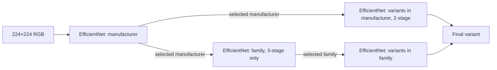
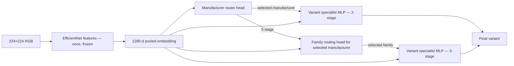

# Experiment specification — FGVC-Aircraft

**Project:** cls-balance  
**Status:** Phases 0–4 implemented; FLAT and IND-2 trained for seeds 42/43/44, with complete validation evaluations and immutable review bundles. Independent full-CNN fitting, hard/oracle routing and residency diagnostics are operational; IND-3 measurement remains gated behind the main two-stage comparison. Test inference, shared-backbone comparisons and full-pipeline latency experiments remain deferred.
**Main hypothesis:** A single frozen, task-adapted EfficientNet backbone plus independently trained specialist heads can approach the accuracy of independently trained EfficientNet cascades with substantially lower end-to-end latency and storage cost.  
**Primary task:** Predict the **aircraft variant** from a single RGB image. Manufacturer and family are intermediate or derived outputs, not substitutes for correct variant prediction.

## 1. Research questions and decision criteria

**RQ1 — Accuracy:** How much variant-classification accuracy is gained or lost when replacing full independently trained backbones with one frozen shared feature extractor?

**RQ2 — Latency:** How much do the two- and three-stage hierarchies cost per **individual image** at batch size 1, including branch selection and feature extraction?

**RQ3 — Error propagation:** What share of mistakes is attributable to early incorrect routing as opposed to within-branch variant discrimination?

**RQ4 — Modularity:** Can a single specialist be updated without retraining other specialists, and what happens to previously learned variants?

**RQ5 — Feature suitability:** Does fine-tuning the shared backbone for the full variant task *before freezing* materially improve the independent specialist heads compared with a generic frozen ImageNet backbone?

### Pre-registered primary endpoints

1. **Variant macro recall** (percentage points): average class recall on the held-out official test split, equivalent to the benchmark's mean per-class accuracy.
2. **p95 batch-1 end-to-end inference latency** (milliseconds): measured for every test image with the complete deployed path.

The main comparison is **IND-2 versus FT-FROZEN-2**; the parallel 3-stage comparison is a depth ablation. Secondary baselines isolate effects of frozen ImageNet features and a flat classifier.

An *exploratory* practical decision rule: consider a shared model compelling if its test variant macro recall is within **2 percentage points** of its independent counterpart while achieving at least **30% lower p95 latency** on the same hardware. These are engineering thresholds, **not proven expected outcomes**. Report actual differences and confidence intervals even if the thresholds are not met.

## 2. Dataset and split policy

**Source:** [FGVC-Aircraft](https://www.robots.ox.ac.uk/~vgg/data/fgvc-aircraft/). The target loader is [Torchvision FGVCAircraft](https://github.com/pytorch/vision/blob/main/torchvision/datasets/fgvc_aircraft.py).

The current Torchvision implementation documents **10,000 images / 100 variants / 70 families / 30 manufacturers**. The source website also describes **10,200 images / 102 variants / 41 manufacturers** in a broader release. Do not combine labels, mappings, or published class counts from different releases.

- Use the *official* `train`, `val`, and `test` splits, with **variant** as ground-truth target.
- Load the three annotation levels and **join by image ID**, not by independent class indices or assumed array order.
- Generate a manifest for each split: `image_id, relative_path, split, variant_id/name, family_id/name, manufacturer_id/name`.
- Generate a deterministic taxonomy map: variant → family → manufacturer; validate every variant maps to precisely one family and manufacturer. Save all class-index/name lookups.
- Verify that IDs do not overlap across the official splits and that every classifier uses exactly the same evaluation image IDs.
- Confirm exact image/class counts from the downloaded dataset in the run metadata; fail loudly if they differ from the expected loader edition.
- Never derive train/validation/test mapping by guessing from label strings.
- Data files, checkpoints, and image samples remain local or in explicitly managed external storage; **do not commit dataset images**.

**Primary image protocol (fixed before training):**

1. Remove the dataset's bottom **20-pixel copyright banner** as documented by the dataset authors.
2. Preserve the full remaining aircraft image (including wings/tail): resize while maintaining aspect ratio and pad to **224 × 224** with a documented fixed color.
3. Apply the normalization required for the selected ImageNet EfficientNet weights.
4. Apply *the same deterministic* preprocessing in all validation/test pipelines.
5. Training augmentations may use mild horizontal flipping and photometric changes with logged parameters; avoid random crops that remove discriminative aircraft parts.

**Optional, separately labeled ablation:** Crop around the provided aircraft bounding box (with specified margin), then resize. This must not be mixed into the primary comparison. The bounding-box coordinates must be adjusted consistently for the banner removal.

The FGVC dataset contains many fine-level singleton branches: with 100 variants across 70 families, at least 40 families have only one variant. A one-class variant branch must return its sole label deterministically; do **not** train a meaningless softmax classifier for it. Record branch depths and the frequency of such shortcuts, because they affect latency. The two-stage experiment (manufacturer → variant) is the most useful main comparison.

## 3. Model variants

All models use the **same EfficientNet-B0 architecture and initialization family**, PyTorch/Torchvision implementation, input size, image preprocessing, split IDs, validation-selection rules, and test harness. FP32 is the first deployment mode; FP16 inference is a separate reproducible experiment.

| Run ID | Backbone | Router/specialists | Hierarchy | Purpose |
| --- | --- | --- | --- | --- |
| FLAT | One ImageNet-initialized EfficientNet-B0 fine-tuned on 100 variants | Single 100-way head | None | Non-hierarchical sanity/feature benchmark |
| IND-2 | Separate ImageNet-initialized EfficientNet-B0 for manufacturer and each manufacturer-specific variant classifier | Independent full CNN models | Manufacturer → variant | Main independent-cascade baseline |
| IND-3 | Separate ImageNet-initialized EfficientNet-B0 for executed classifier nodes | Independent full CNN models | Manufacturer → family → variant | Impact of extra depth |
| FROZEN-2 | Single ImageNet-pretrained **frozen** EfficientNet-B0 | Independent manufacturer head + manufacturer-specific variant MLP heads | Two-stage | Generic frozen features |
| FROZEN-3 | Same single ImageNet-frozen backbone | Independently trained routing heads and variant heads | Three-stage | Generic features/depth |
| FT-FROZEN-2 | **One FLAT-trained backbone**, final classifier removed, then frozen | Independently trained manufacturer and variant MLP heads | Two-stage | **Main proposed architecture** |
| FT-FROZEN-3 | Same fine-tuned frozen backbone | Independently trained hierarchical heads | Three-stage | Fine-tuned shared features/depth |

Train a **single FLAT checkpoint per seed** and reuse its frozen feature extractor for both FT-FROZEN-2 and FT-FROZEN-3. The FLAT classifier is not applied at deployment for the latter two. Checkpoint leakage is forbidden: train the shared backbone only with the training split, select/check hyperparameters with validation data, and do not train on test images.

### Independent cascade (hard routing)



- Train each model using only samples appropriate to its supervised task. Route the **inference** image with *predicted* upstream labels (never ground truth in normal evaluation).
- When an intermediate branch has one valid child, bypass the corresponding classifier and return the known child. Report the executed path length per sample.
- Independently trained means **separate weights and checkpoints** for each full EfficientNet node. Do not share an unadvertised feature cache across independent CNNs.
- All possible weights must be counted for **total artifact size**. GPU residency must be documented (see §7).

### Shared frozen backbone (hard routing)



- A shared backbone processes each image **exactly once**.
- Each small MLP head (for example, `Linear(1280,256) → ReLU → Linear(256,n_classes)`) operates on **the same frozen features**, with independent weights and optimizer state.
- The manufacturer router and specialist heads are distinct independently trained modules. Family routing is **conditional on the predicted manufacturer** for the 3-stage configuration.
- The final output must be a globally valid variant identifier, never a specialist's local index.
- For hard routing, softmax scores from a local head are not directly calibrated global probabilities. If confidence scores are compared, explicitly define conditional joint path probabilities and a calibration protocol using validation data.
- **Do not run every specialist** during deployment inference; execute only the predicted branch, unless explicitly running a separately reported top-k/soft-routing ablation.
- Store `backbone_version`, `preprocessing_version`, `taxonomy_version` with every head artifact. Changing backbone weights invalidates compatibility unless heads are revalidated or retrained.

**Optional follow-up:** On challenging families, compare pooled embeddings against a small spatial CNN head attached to an intermediate EfficientNet feature map. Keep this separate from the main test, because it changes the computational cost and specialist capacity.

## 4. Fair training protocol

Initial recommended recipe (adjust on **validation only**, and retain the same selection policy across variants):

| Setting | Starting value / policy |
| --- | --- |
| Backbone | `efficientnet_b0`, same ImageNet weights |
| Resolution | 224 × 224 |
| Train seeds | 42, 43, 44 (minimum) |
| Training optimizer | AdamW |
| Full-backbone LR | 1e-4 starting point |
| Head-only LR | 1e-3 starting point |
| Loss | Multiclass cross-entropy |
| Epoch cap | 30 per model initially |
| Early stopping | Validation score, patience 7, restore best checkpoint |
| Validation score | Local macro recall; track cross-entropy too |
| Training precision | Record per run; start with consistent FP32 |
| Sampling | Document and keep baseline policy consistent; no unlabeled extra data |

**Training order:**

1. Train `FLAT` using all 100 variant training classes; select by variant validation macro recall.
2. Independently train `IND-2` and `IND-3` routing nodes and specialists from the same specified ImageNet initialization.
3. Freeze the original ImageNet backbone and train the `FROZEN-*` routing/specialist heads.
4. Remove `FLAT`'s final classification layer, freeze its trained backbone, and separately train `FT-FROZEN-*` heads.
5. Evaluate all selected checkpoints under the **same** harness. No architecture gets access to test labels during training or model selection.

**Important fairness caveat:** Independent node networks see different numbers of examples and potentially have vastly more trainable parameters and cumulative training compute. Report wall-clock training time, GPU-hours (where available), total optimizer steps, number of trained parameters, and training data exposures. Do not pretend the experiment controls for equal total training compute when it does not. For a compute-matched ablation, define an explicit GPU-hour cap as a secondary study.

**Feature caching:** Frozen-backbone heads can train from cached `float32` pooled embeddings computed from the deterministic preprocessing. Log whether caching is used. If applying stochastic augmentation, either recompute image features per epoch or cache explicitly versioned augmented views. Cached inference features are **not** used to make deployed latency look smaller.

## 5. Classification evaluation

### Primary metric: variant macro recall

For `C` final variants, with `TP_c` and `FN_c` measured on the same test IDs:

```text
macro_recall = (1/C) * sum_c TP_c / (TP_c + FN_c)
```

Use explicit globally aligned variant IDs and a fixed class list. This is the dataset benchmark's mean per-class accuracy, computed as the mean diagonal of the row-normalized confusion matrix.

### Secondary classification metrics

- **Variant micro accuracy / Top-1** — proportion of images assigned the correct variant.
- **Macro-F1** — mean per-variant F1, helpful for imbalanced error patterns.
- **Manufacturer and family accuracy** — project the **final predicted variant** through the taxonomy and compare with the true ancestor. Keep separate any intermediate-router accuracies.
- **Top-k variant accuracy** (optional) — only if comparable globally valid variant scores are computed, not by comparing unrelated local softmax scores.
- **Confusion matrix** at variant level; additionally aggregate confusion within and across families/manufacturers.
- **Per-class recall** and **per-branch support** with variance, especially for small specialist branches.

### Routing diagnostics

Always distinguish:

1. **Normal hard-route variant accuracy:** upstream routing uses predicted labels. This is the actual production performance.
2. **Oracle routing variant accuracy:** supply **true** manufacturer (2-stage), or **true** manufacturer and family (3-stage), to choose the specialist; then score its variant prediction. Oracle routing is diagnostic only, not a deployable headline metric.
3. **Manufacturer-router accuracy:** correctness of the first-stage output.
4. **Conditional family-router accuracy:** correctness *given the true manufacturer branch*; also report whole-pipeline family prediction accuracy under predicted routing.
5. **First wrong decision distribution:** manufacturer vs family vs variant stage.
6. **Routing penalty:** oracle variant accuracy minus normal hard-route variant accuracy, **on the same images**.

Calculate the 3-stage conditional metrics using the right denominators and label them explicitly. A manufacturer error makes all downstream variants outside the correct branch unreachable; do not hide those failures by reporting only specialist accuracy.

**Class imbalance:** even when each variant has the same source sample count, manufacturer-level training distributions are imbalanced because manufacturers have different numbers of variants. Record routing confusion and manufacturer macro recall. Balanced sampling/weighted loss can be an ablation after the base experiment, with the same approach applied fairly to both architectures.

## 6. Performance and deployment measurements

**Primary speed benchmark:** GPU (or chosen inference device), **batch size 1**, models in inference/eval mode, `torch.inference_mode()`, same dtype and hardware, identical input tensors and pre/postprocessing.

Record two latency definitions separately:

- **Model-path latency:** from ready tensor through all executed models and routing until final variant ID.
- **Full pipeline latency:** load/decode or memory-resident input (state which), deterministic preprocessing, host→device transfer, executed model path, and final ID transfer. **This is the primary p95 endpoint** for the chosen explicit pipeline boundary.

Include **p50**, **mean**, **p95**, and **p99** latency in milliseconds; report CPU/GPU execution separately where useful.

**CUDA:** warm up model(s) and representative branch paths, synchronize the GPU before and after CPU wall-clock timing with `time.perf_counter()`, or use CUDA events for isolated GPU kernels. GPU operations are asynchronous; timings without synchronization are invalid. Warm up enough representative branches to avoid conflating first-use initialization with steady-state latency; report cold-start separately if relevant.

- Measure over the **whole official test split**, with per-sample paths and times retained; repeat benchmark passes (e.g. 5) and report distribution across passes.
- Fix GPU, driver, PyTorch, Torchvision, CUDA/cuDNN, clocks/power mode if controllable, tensor dtype, model residence policy, and worker count. Report ambient/system load, particularly on laptops.
- If the independent cascade cannot fit all models in GPU memory simultaneously, use a **clearly labeled on-demand residency policy** and count model-loading/transfer in corresponding realistic full-pipeline latency. Do not compare an all-resident shared system against an independently cached-to-disk cascade without stating the tradeoff.
- Report **sustained FPS** from elapsed time for a continuous processing run, independently of per-image p50 (do **not** call `1000/p50_ms` measured throughput).
- Count per-image executed-backbone passes, per-branch MACs/FLOPs (using a single convention and profiler), total parameters across stored models, trained parameters, checkpoint storage in MB, peak allocated GPU memory and peak resident memory when available.
- Do not sum MACs for branches not invoked for the image. Do not omit stored-but-inactive specialist weights from total deployment size.
- Run FP32 primary; compare FP16 as a separate inference-only deployment ablation with exactly the same trained checkpoints and inputs, noting any accuracy change.

## 7. Specialist-update experiment

This is the key extensibility demonstration, with **no contamination of the initial backbone**:

1. Pick a manufacturer with multiple variants using a predeclared, deterministic rule based on the *training taxonomy* (for instance, alphabetically first manufacturer with at least three variants). If a target variant is to be introduced, preselect that variant deterministically from this family.
2. Remove **all training/validation samples of the target new variant** from the initial `FLAT` backbone fine-tuning and *all* initial heads/specialists. Do not use the target class in any initial checkpoint selection.
3. Train initial models with the remaining known classes and a reduced taxonomy. Record initial accuracy only on previously known variants.
4. Introduce the target variant's **training samples only**, and expand/retrain the relevant specialist using training examples of both new and existing classes; tune on the corresponding validation portion.
5. Leave every **other** specialist and both shared backbone and unaffected router frozen. For an existing manufacturer this typically requires no router change.
6. Compare update cost against the independent cascade's affected full EfficientNet specialist, and optionally the flat model's more global fine-tuning or retraining. Do **not** treat `FLAT` as independently modular.
7. Evaluate the before/after models on a fixed set of known-class test images and, **after** introduction, the new-variant test images (not used for training or early stopping).
8. Report new-variant recall, updated specialist old-class recall, unchanged-family accuracy, overall accuracy, trainable parameter count, elapsed update time, and saved replacement artifact size.

If the new variant belongs to an initially empty family, this is a *new-family routing* experiment and must be reported separately; it is not a pure specialist update. An update is modular only if the backbone and all unrelated heads are bit-for-bit unchanged and their version compatibility is preserved. As a functional test, unaffected heads should produce exactly the same logits when passed the same cached features; their *frequency of invocation* may still change if the router is modified.

## 8. Reporting and statistics

Run at least **three training seeds** (42/43/44). For each seed, compare architectures using the *same* test image IDs. Record each architecture's mean and standard deviation across seeds.

For paired accuracy comparisons, compute **95% paired bootstrap intervals**, sampling test images stratified by true variant so classes stay represented; for the primary macro-recall difference, report `shared - independent` in **percentage points**. Distinguish variability across samples from variability across training seeds; bootstrap one fixed model pair per seed and summarize separately rather than treating seeds as independent images.

Latency: retain **per-image** observations and summarize p50/p95 and their uncertainty from repeated passes. Report the full per-image latency distribution grouped by observed path depth (to explain singleton/branch effects).

Publish:

- Architecture/seed/hyperparameters and chosen checkpoint IDs.
- Dataset edition and taxonomy checksum; complete preprocessing transforms.
- **Per-test-image predictions and timing** (`image_id, true_variant, predicted_variant, predicted_manufacturer, predicted_family, route, latency_ms`) for error auditing, without copying copyrighted images.
- Aggregate `metrics.json`, classwise CSV, confusion matrices, throughput/resource tables.
- Accuracy-versus-p95-latency plot with Pareto frontier.
- Routing penalty, oracle/actual accuracy gap, and specialist update comparison.

Use `docs/RESULTS_TEMPLATE.md` as the published report format. Never insert synthetic measurements as though they are experiment results.

## 9. Required implementation checks

- Taxonomy is a valid tree/forest for the active label edition; each variant has one unique family and manufacturer.
- All splits are disjoint by image ID; no evaluation image enters training, embedding caches used for training, or hyperparameter selection.
- Each specialist's local logit index converts correctly into one of its allowed **global** variant labels.
- Single-child branches produce deterministic valid predictions without executing an extra CNN/MLP.
- All architectures' evaluations use identical image IDs and exact image preprocessing.
- A mocked perfect manufacturer/family router yields oracle and hard-route results that agree.
- An intentionally wrong manufacturer route cannot accidentally receive the correct global variant prediction.
- `torch.inference_mode()` and GPU synchronization are active in the benchmark path.
- Save/load round-trip preserves predictions; specialist artifact carries correct backbone/preprocessing/taxonomy version.
- Resource accounting covers all stored independent models, and per-image compute counts only the executed path.
- Incremental experiment explicitly asserts the target variant was absent from initial training and validation.

## 10. Risks and interpretation

| Risk | Consequence | Mitigation |
| --- | --- | --- |
| Very small variant specialists (many singleton families) | Misleading speed/accuracy improvements | Favor two-stage as main test; report shortcut rates |
| Hard routing errors | Earlier mistakes cannot be corrected | Report oracle routing and first-wrong-stage analysis |
| Frozen features discard subtle details | Shared heads saturate below independent CNNs | Compare ImageNet-frozen vs variant-fine-tuned frozen; optional spatial heads |
| Larger number of independently trained nodes | High total training/storage cost | Track actual GPU-hours, total checkpoint size and loading behavior |
| Aircraft background shortcuts | Inflated apparent recognition | Shared preprocessing, image-based error inspection, optional crop ablation |
| Small official per-variant test counts | Wide uncertainty on per-class gains | Multiple seeds and paired stratified bootstrap |
| Fine-tuning leak into incremental holdout | Invalid modularity claim | Exclude new variant before training *all* initial backbones |
| Hardware or precision confounds | Invalid latency comparison | Fixed deployment config and detailed timing metadata |

## 11. Phases and deliverables

Detailed action items are in [ROADMAP.md](ROADMAP.md).

1. **Data + taxonomy**: download, manifest, validation, reproducible transforms.
2. **Evaluation harness**: metric calculations, deterministic routing, latency/memory logger, unit tests.
3. **FLAT baseline**: all-variant EfficientNet and trained feature checkpoint.
4. **IND-2 / IND-3**: independent models, routing/oracle performance, end-to-end timings.
5. **FROZEN / FT-FROZEN**: shared backbone, cached features, independently trained heads.
6. **Analysis**: aggregate seed results, paired statistics, confusion and Pareto plots.
7. **Modular update**: new-variant introduction and localized retraining.
8. **Reproduction/report**: env-lock, seeds, hardware manifest, commands and results.

## 12. References and constraints

- [FGVC-Aircraft dataset and official evaluation](https://www.robots.ox.ac.uk/~vgg/data/fgvc-aircraft/) — reference mean per-class accuracy, splits, bbox, dataset constraints.
- [Torchvision FGVCAircraft source](https://github.com/pytorch/vision/blob/main/torchvision/datasets/fgvc_aircraft.py) — target loader labels and edition.
- [Torchvision EfficientNet-B0 model and weights](https://pytorch.org/vision/stable/models/generated/torchvision.models.efficientnet_b0.html).
- [PyTorch inference mode](https://pytorch.org/docs/stable/generated/torch.inference_mode.html).

Respect the dataset terms for non-commercial research and attribution. Repository source code may have its own license, but the dataset is not redistributed here.

---

**Completion criteria:** The project is only complete when all primary architectures train from clean official splits, every claim links to saved per-seed/per-image measurements, the specialist update protocol is leak-free, and the latency/accuracy comparisons can be independently reproduced on a stated hardware configuration.
