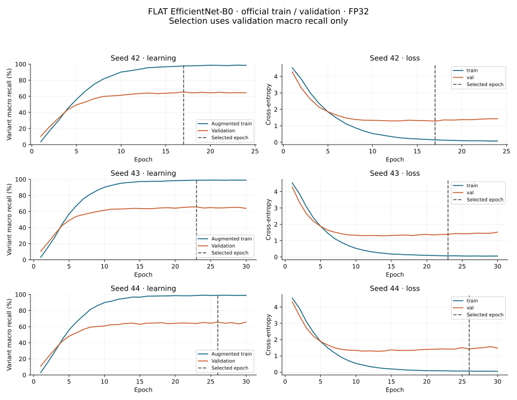
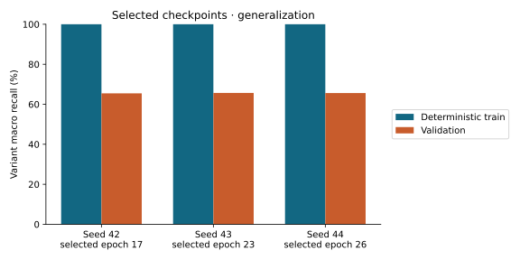
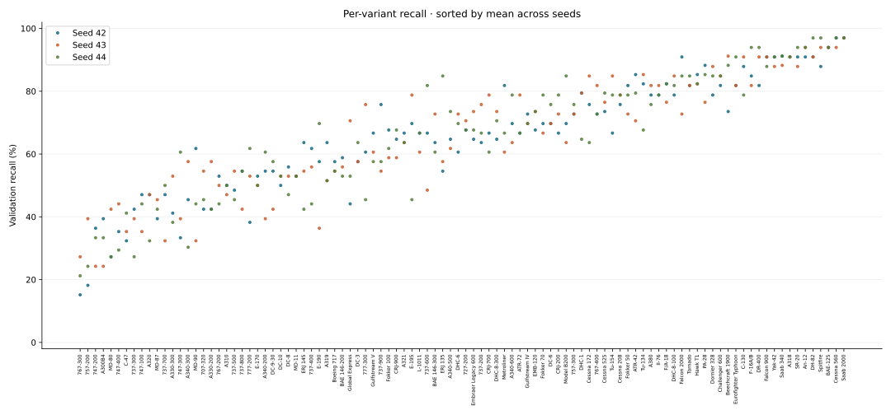

# Phase 3 — measured FLAT baseline

FLAT EfficientNet-B0 was trained on all 3,334 official training images and selected using macro recall on all 3,333 validation images. Test inference was deferred until the comparison settings are frozen. These are validation results; they do not establish the main IND-2 versus FT-FROZEN-2 claim.

## Experimental context

- Dataset: Torchvision FGVC-Aircraft, 100 variants / 70 families / 30 manufacturers; 3,334 / 3,333 / 3,333 official splits.
- Training Git SHA: `aa18ef15283ba9a7abcec22ac213c1f842717966`; dirty flags by seed: `{42: False, 43: True, 44: True}`. Per-seed source hashes record the training snapshot; publication metadata fingerprints the report-generation sources.
- Device: `cuda:0`; GPU: `['NVIDIA GeForce RTX 3060 Laptop GPU']`; Torch: `2.9.1+cu128`; CUDA: `12.8`.
- Dataset manifest (canonical JSON records): `27a7dd09275ac80cee1769b5fd7d5f28fe29feaeb54d955b16cb3ce227500253`.
- Taxonomy: `a79cf6f7fe8a7a028c1f2b51619b307750a241c26d863c0fc983423a6dd48177`; preprocessing: `173fd93e7491bb9048ffe5257c364450fa69b3f0e1ac4b1a4cf965eddea78adc`.
- FP32, TF32 disabled, deterministic algorithms, OS/driver power defaults. Training uses shuffled batches of 16; final evaluation uses the common batch-1 adapter.
- ImageNet V1 initialization; full fine-tuning with AdamW, LR 0.0001, weight decay 0.01; cap 30 epochs; patience 7; earliest epoch wins a validation-score tie.
- Remove bottom 20-pixel banner, preserve aspect ratio, center black padding to 224×224, ImageNet normalization. Training adds deterministic mild flips and photometric jitter.

## Selected-checkpoint measurements

| Seed | Selected / completed epochs | Train macro recall (%) | Validation macro recall (%) | Validation top-1 (%) | Training hours |
| --- | --- | --- | --- | --- | --- |
| 42 | 17 / 24 | 100.00 | 65.48 | 65.44 | 0.415 |
| 43 | 23 / 30 | 100.00 | 65.66 | 65.62 | 0.513 |
| 44 | 26 / 30 | 100.00 | 65.61 | 65.56 | 0.516 |

Validation macro recall across the recorded seeds: **65.58%** ± 0.10 pp (sample standard deviation). This spread measures training-seed variability, not a confidence interval or test performance.



Dashed lines mark selected epochs. Training curves use augmentation and training mode; final train scores below use deterministic preprocessing and eval mode. A train/validation gap indicates generalization limits; no settings were selected with test labels.





Per-class support and global class names are in each seed's validation CSV. Recall estimates have only 33 or 34 validation examples per class.

## Artifact and encoder checks

All seeds produced hash-checked full and encoder-only checkpoints. Reloaded logits and pooled embeddings matched exactly on a fixed validation input on the same device. Encoders copy only the selected features/pooling, return 1,280 dimensions, disable gradients and remain in eval mode. Checkpoint files stay local under ignored `runs/`; `checkpoint_references.json` records their file/state hashes. Validation predictions and aggregate train metrics are included; dataset images and training-image ID lists are excluded.

## Limitations and protocol deviations

Only Phase 3 is measured. IND-2, FT-FROZEN-2, oracle routing, p95 latency, sustained FPS, inference memory, MACs and incremental updates remain unmeasured. Training wall time includes epoch training, validation and checkpoint selection; it is not an inference benchmark. GPU clocks were not locked, and other desktop applications may affect elapsed time. The archive-checksum discrepancy documented in Phase 1 remains applicable. No dataset subset, resolution change, test-label tuning, mixed precision or optimizer recipe change was introduced.

## Reproduction and audit

From the repository root:

```powershell
.venv-cuda/Scripts/python.exe -m cls_balance.train --config configs/flat.yaml
.venv-cuda/Scripts/python.exe -m cls_balance.report_flat --runs <run-seed-42> <run-seed-43> <run-seed-44> --output-root results/stage3
.venv/Scripts/python.exe scripts/freeze_tests.py --check
.venv/Scripts/python.exe -m pytest -q
.venv/Scripts/python.exe -m pytest -q checks/
```

Replace report placeholders with the local run directories recorded below. Full environment/configuration, histories, resource accounting, audited per-image validation predictions, classwise metrics and row-normalized confusion matrices accompany this report. Reproduction creates new immutable run IDs.

Implementation test output and additional export-audit commands are linked from the [repository README](../../../README.md).

- Seed 42: `flat-s42-20261025T031340Z-5385e556`; [validation metrics](seed-42/validation/metrics.json); [confusion](confusion-seed-42.svg).
- Seed 43: `flat-s43-20261025T034152Z-d43e9130`; [validation metrics](seed-43/validation/metrics.json); [confusion](confusion-seed-43.svg).
- Seed 44: `flat-s44-20261025T041556Z-40c093b2`; [validation metrics](seed-44/validation/metrics.json); [confusion](confusion-seed-44.svg).
