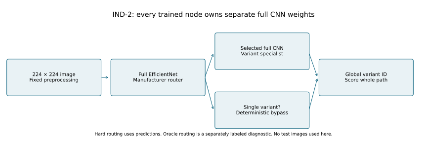
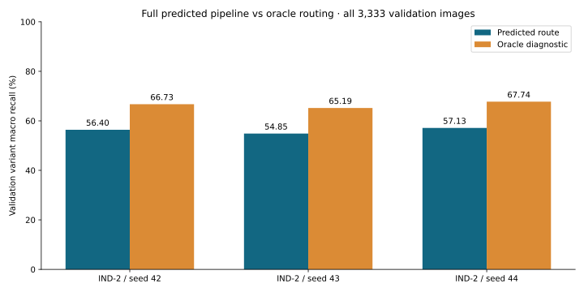
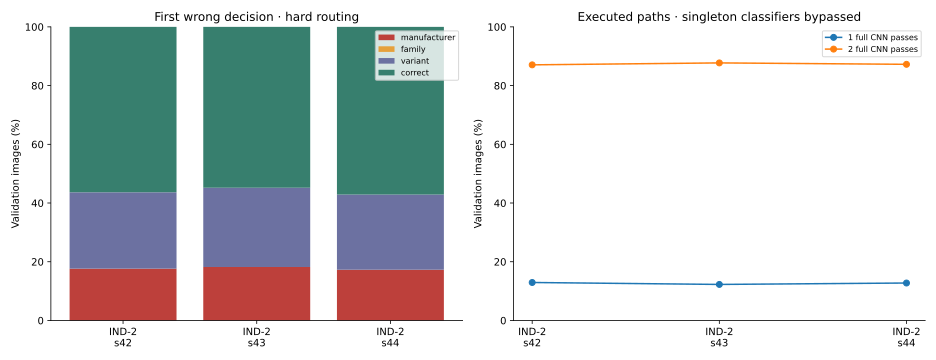
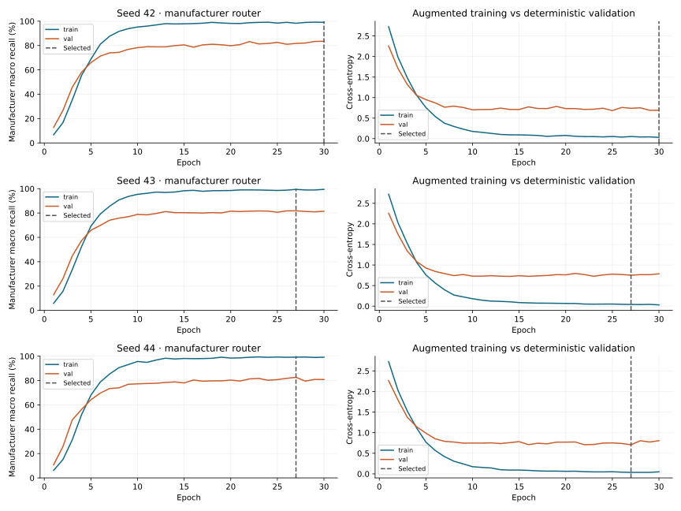
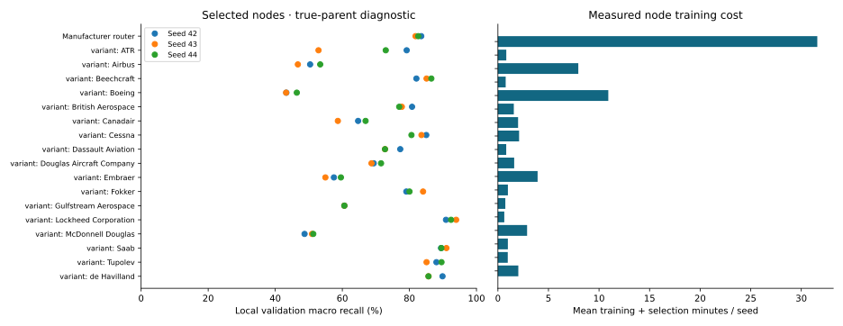
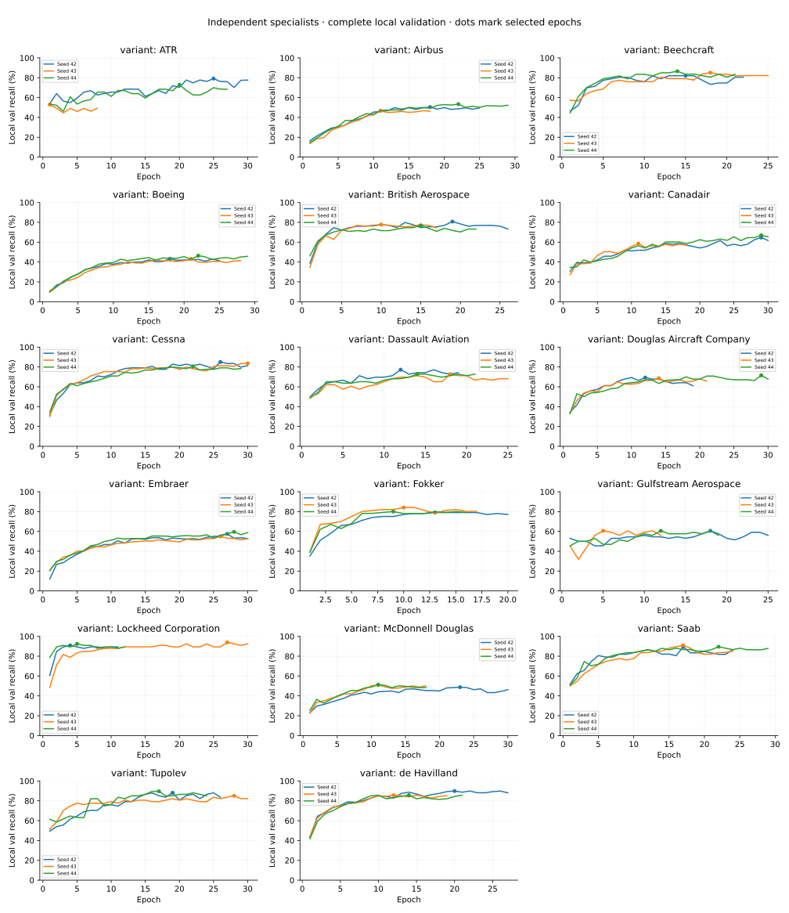
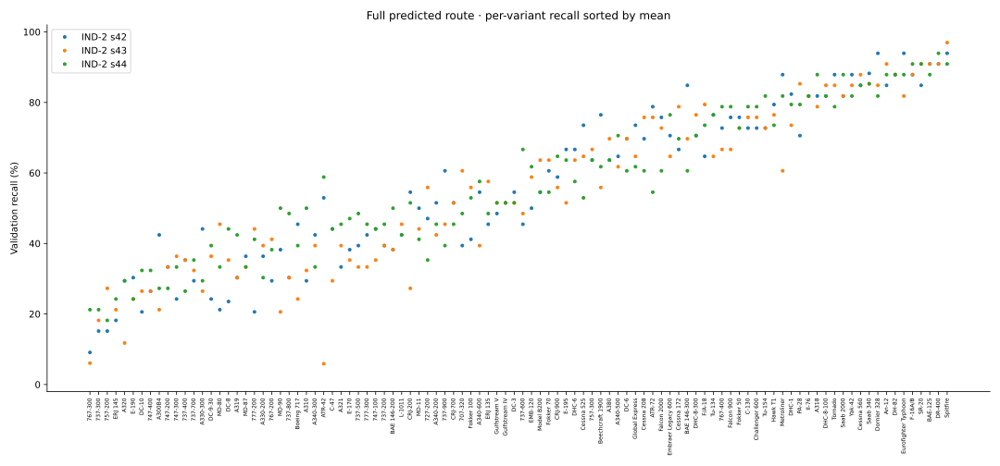
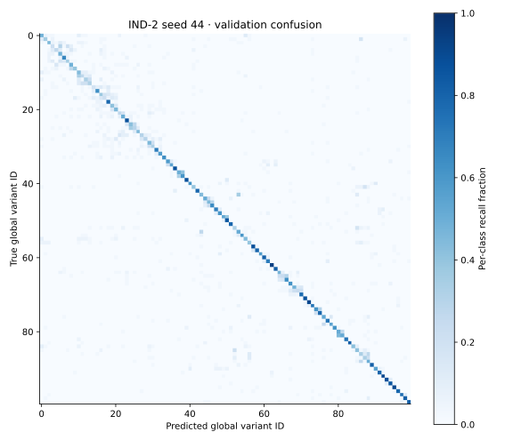

# Phase 4 — Independent hierarchical validation

## 1. Experimental context

Official Torchvision edition: 100 variants / 70 families / 30 manufacturers; 3,334 train / 3,333 validation / 3,333 held-out test images.
FP32 EfficientNet-B0, ImageNet V1 initialization, 224×224 banner removal + aspect-preserving resize/pad. Each node is trained independently on its true supervised training branch and selected by local validation macro recall.

Seeds: 42, 43, 44. Device: cuda:0; ['NVIDIA GeForce RTX 3060 Laptop GPU']. Torch 2.9.1+cu128, CUDA 12.8. OS power defaults; clocks not locked. All classifiers resident during validation.

Publication ID: `independent-20261027T071605Z-64675e2e` (UTC timestamp). Training source base Git SHA: `1af6c0f725bbc35991f67daf971a5e10ecb6148f`; dirty working tree: `True`. Exact training/evaluation source hashes are saved per seed; the final Git commit additionally includes reporting and documentation.

Taxonomy SHA256: `a79cf6f7fe8a7a028c1f2b51619b307750a241c26d863c0fc983423a6dd48177`. Preprocessing: `173fd93e7491bb9048ffe5257c364450fa69b3f0e1ac4b1a4cf965eddea78adc`. Manifest: `27a7dd09275ac80cee1769b5fd7d5f28fe29feaeb54d955b16cb3ce227500253`.

## 2. Validation comparison (test endpoints deferred)

These are complete validation predictions, not held-out test results. Oracle values are diagnostics. The shared-backbone comparison and synchronized full-pipeline p95/FPS benchmark remain Phases 5–6; no speed claim is made.

| Architecture / seed | Variant macro recall % | Top-1 % | Macro-F1 % | Family from variant % | Manufacturer from variant % | Oracle macro recall % | Oracle − hard pp |
| --- | --- | --- | --- | --- | --- | --- | --- |
| IND-2 / 42 | 56.40 | 56.35 | 56.14 | 67.96 | 82.36 | 66.73 | 10.33 |
| IND-2 / 43 | 54.85 | 54.79 | 54.58 | 67.54 | 81.79 | 65.19 | 10.34 |
| IND-2 / 44 | 57.13 | 57.10 | 56.94 | 68.95 | 82.72 | 67.74 | 10.61 |

IND-2 validation macro recall: 56.13% ± 1.17 pp sample SD.

## 3. Paired differences and uncertainty

No shared/independent test comparison or bootstrap interval is available at this phase. Engineering thresholds are unassessed.

## 4. Routing and singleton paths







All normal routes use predicted ancestors. Oracle forces ancestors only and still classifies the final variant. Per-image decisions, bypasses and executed CNN counts are saved in each validation CSV. Conditional family diagnostics, when present, use the true manufacturer in a separate pass.

## 5. Resources and residency

| Architecture / seed | Full CNN nodes | Stored MB | Trainable parameters | Train + selection hours | Training image exposures | Optimizer steps |
| --- | --- | --- | --- | --- | --- | --- |
| IND-2 / 42 | 18 | 294.43 | 72285741 | 1.247 | 174123 | 11187 |
| IND-2 / 43 | 18 | 294.43 | 72285741 | 1.145 | 166161 | 10654 |
| IND-2 / 44 | 18 | 294.43 | 72285741 | 1.273 | 175141 | 11243 |

Storage counts all classifier artifacts, including inactive branches; execution counts include only the selected path. Training hours include epoch validation and checkpoint selection, excluding initialization/export/final evaluation. Reused manufacturer training is counted in each architecture's standalone cost; do not sum architectures to infer unique experiment GPU hours.

Cold-disk and preloaded-CPU are separately invocable residency policies. Disk mode retains OS filesystem caches and performs integrity-checked loading on every selected node call; CPU mode retains full CPU nodes and transfers/evicts selected weights inside prediction. The Phase 6 full-pipeline benchmark must include those operations when using either policy.

## 6. Specialist training review

Each row in [nodes.csv](nodes.csv) gives branch name, support, seed, selected epoch, local validation score, exposures, optimizer steps and measured cost. Per-node histories and checkpoint hashes are under each seed directory. Local true-parent scores are not whole-pipeline accuracy.









## 7. Confusion matrices




## 8. Limitations and phase gates

Test inference, final uncertainty, latency/FPS/MACs, the shared architectures and incremental updates remain unmeasured. IND-3 is implemented and checked on generated fixtures; training it is opt-in after the primary two-stage comparison, following the repository execution order. No training dataset images, training-image ID lists, embeddings or weights are published.

## 9. Reproduction and evidence

```powershell
& .\.venv-cuda\Scripts\python.exe -m cls_balance.train_independent --config configs/independent.yaml
& .\.venv-cuda\Scripts\python.exe -m cls_balance.report_independent --runs runs/independent/ind-s42-20261026T125759Z-6d87251e runs/independent/ind-s43-20261026T141824Z-b8c12b2c runs/independent/ind-s44-20261026T153237Z-2b462c75 --output-root results/stage4
```

| Seed | Run ID | Config SHA256 | Source snapshot |
| --- | --- | --- | --- |
| 42 | `ind-s42-20261026T125759Z-6d87251e` | `f21e481dc240cff4c38be94302b388bfe72676e45c376face687331b8e33d84d` | [hashes](seed-42/source_hashes.json) |
| 43 | `ind-s43-20261026T141824Z-b8c12b2c` | `1f73b2cf16d208b17fb82d018ccf6f9f8723ab08ac861c5c2d083c4debc4b746` | [hashes](seed-43/source_hashes.json) |
| 44 | `ind-s44-20261026T153237Z-2b462c75` | `ed7e30a1a04500730a5d1232e0575fb86713a123f355f2af3217be23da306a75` | [hashes](seed-44/source_hashes.json) |
