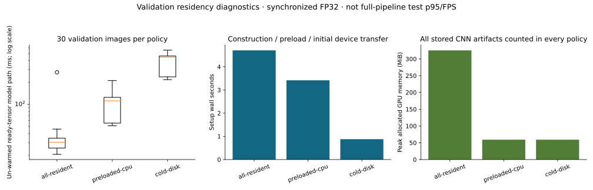

# Phase 4 validation evidence

213 tests passed with no failures, errors or skips. The original
172-test suite and runner inputs pass their frozen SHA256 audit. Both pinned CPU
and CUDA environments pass `pip check`.

The Phase 4 checks cover real EfficientNet export/reload, independent parameter
storage, taxonomy-to-local target mapping, singleton exclusion, two- and
three-stage optimizer/bundle/evaluation orchestration on generated fixtures,
hard/oracle routes, residency equality, verified node reuse, tamper rejection
and publication exclusion of training-ID contracts. Generated fixtures are not
aircraft measurements.

The [measured training report](../independent-20261027T071605Z-64675e2e/REPORT.md) contains genuine
full validation predictions for seeds 42/43/44. [Residency probes](residency/summary.json)
compare all-resident, preloaded-CPU and cold-disk paths on the same 30 validation
images. These un-warmed ready-tensor probes are not test p95/FPS measurements.
The first probe failed before recording measurements because CUDA peak-stat
reset preceded allocator initialization. A released sentinel allocation now
bootstraps the allocator before all policy timers; CUDA runtime startup is
excluded. The corrected probe passed and its raw failed-start log is retained.



The [interrupted attempt](interrupted-attempt.json) completed one epoch before
the decoding-policy restart. No partial checkpoint is published as a result.
Its epoch-one accuracy/loss observations exactly match the restarted run.
Any partial epoch after that completed epoch is unmeasured; successful-run
resource totals exclude the abandoned attempt.
The [user-requested pause](user-pause-attempt.json) interrupted seed 44 after
seven complete router epochs. Those metrics were retained, while the incomplete
node restarted in a new attempt on explicit continuation. Its discarded-epoch
costs and any unmeasured partial epoch are excluded from successful-run totals.
Exact scientific metric reproduction: 7 of 7
completed pre-pause epochs (wall-clock timings excluded).
The [system-sleep attempt](system-sleep-attempt.json) retained 20 discarded Airbus
epochs, including a validation epoch spanning the 6.2-hour sleep. This elapsed
time is not active GPU time. Only the affected incomplete node restarted; all
38 previously completed CNNs were preserved. Successful-run resources exclude
that entire attempt. A temporary process-lifetime idle-sleep request protected
the retry without altering the OS power plan, display settings or clock policy.
The first auxiliary launcher failed Windows multiprocessing startup before any
new epoch completed. Its [two empty attempts](failed-launcher-attempts.json) were
retained; a main import guard corrected the launcher and a separate spawn smoke
check passed before the successful retry. The core trainer source stayed unchanged.
Source/configuration/environment snapshots and console output are included;
dataset images, training-ID lists, embeddings and weights remain local.

## Exact checks

```powershell
& .\.venv\Scripts\python.exe scripts/freeze_tests.py --check
& .\.venv\Scripts\python.exe -m pytest -q tests checks --junitxml=.tmp-phase4-final-junit.xml
& .\.venv\Scripts\python.exe -m pip check
& .\.venv-cuda\Scripts\python.exe -m pip check
```

IND-3 real-data training is gated after the primary two-stage comparison.
Test inference and full-pipeline speed benchmarks remain deferred. Training
wall time includes ordinary OS/background load; CPU checks overlapped early
router epochs. No equal-compute or deployment-speed claim is made.
