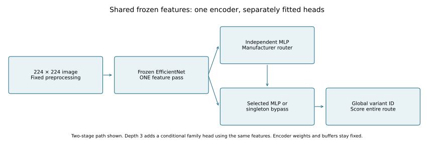
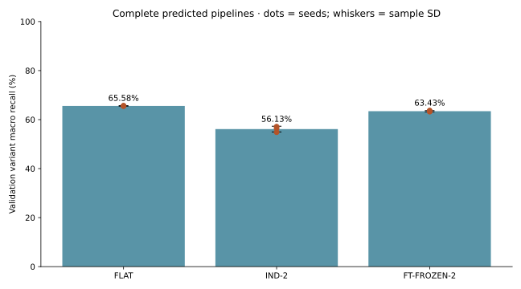
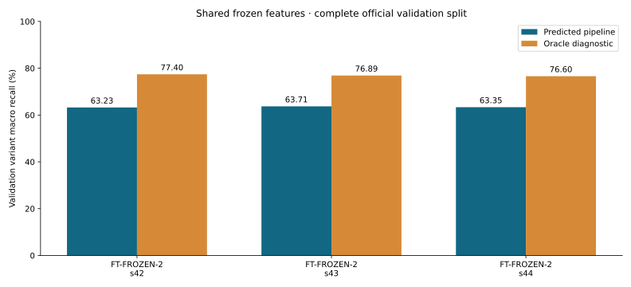
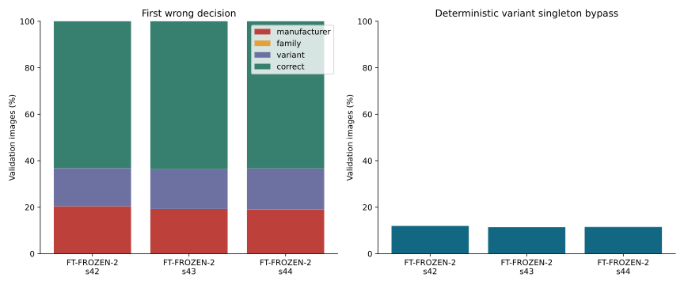
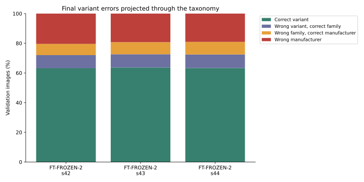
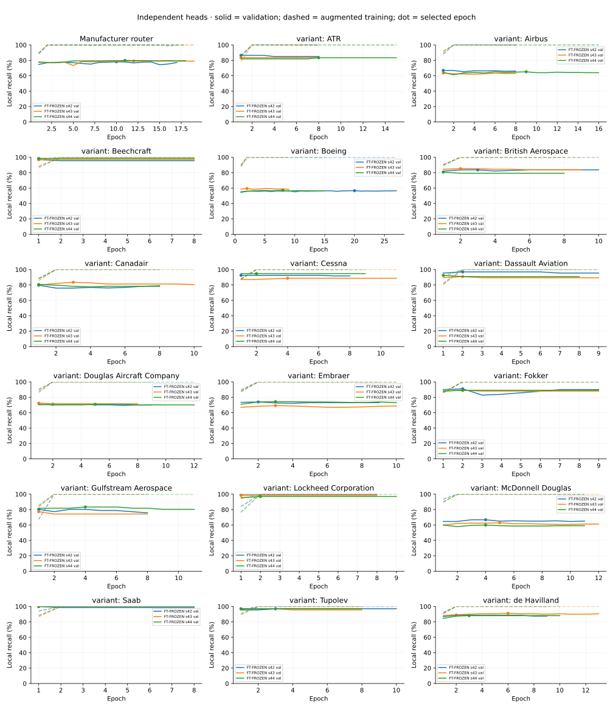
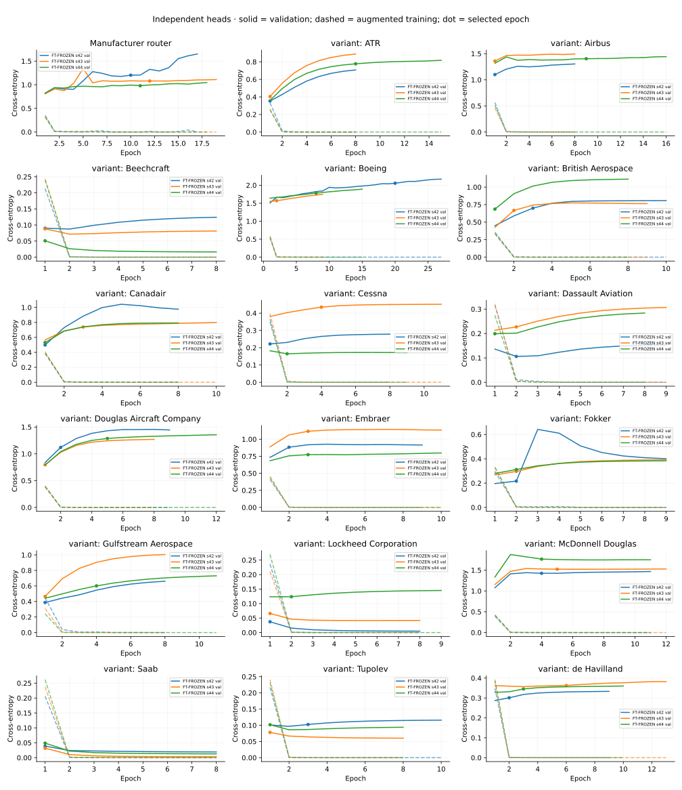
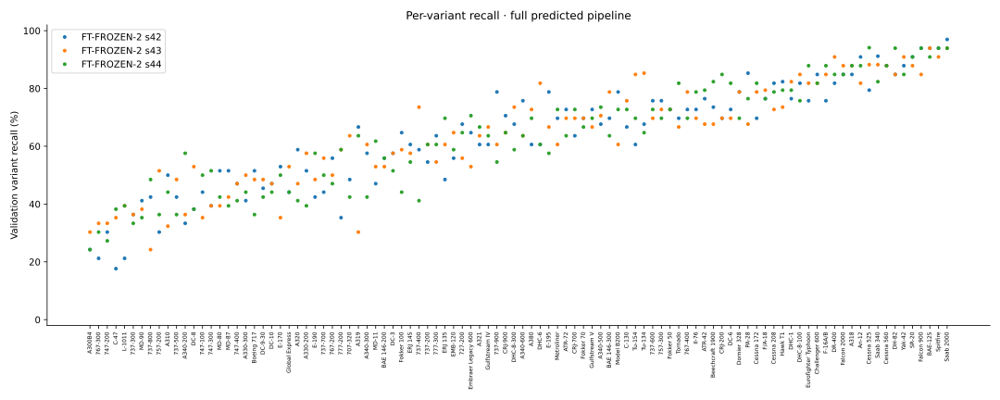
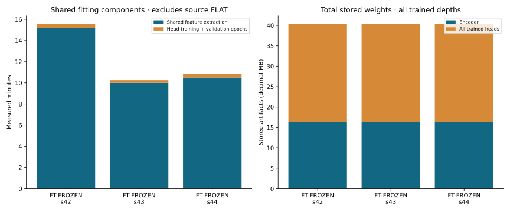

# Phase 5 — measured frozen shared-backbone heads

Complete official FGVC-Aircraft train/validation splits: 3,334 / 3,333 images, 100 variants / 70 families / 30 manufacturers. These are validation measurements; test inference and the Phase 6 latency/FPS benchmark remain deferred. No test labels entered training or selection.

## Experimental context and controls

Seed-matched Phase 3 FLAT encoders supply FT-FROZEN features; generic FROZEN uses published ImageNet V1 features. Each head is a separately initialized Linear(1280,256) → ReLU → Linear(n) with independent AdamW state, shuffle generator, early stopping and checkpoint. Learning rate 0.001, weight decay 0.01, cap 30, patience 7; strict local validation macro-recall improvement, earliest tie. The same selected router can be reused across depths. Singleton nodes have no classifier.

FP32, TF32 disabled; ['NVIDIA GeForce RTX 3060 Laptop GPU']; Torch 2.9.1+cu128, CUDA 12.8. Per-seed environments record Git SHA/dirty state and source hashes bind the actual training code. Dataset manifest: `27a7dd09275ac80cee1769b5fd7d5f28fe29feaeb54d955b16cb3ce227500253`. Preprocessing: `173fd93e7491bb9048ffe5257c364450fa69b3f0e1ac4b1a4cf965eddea78adc`. Remove the bottom 20 pixels, preserve image aspect ratio, black-pad to 224×224 and normalize with ImageNet V1 statistics.

Fresh seeded flip/photometric augmentation is extracted once per training image per epoch, then shared read-only among independently optimized heads. Validation features are deterministic and held in memory for local selection. Disk training cache enabled: **False**. Full predicted/oracle evaluation reads images through the common batch-1 adapter; no deployment embedding cache is used.



## Classification and routing measurements

| Architecture | Seed | Hard macro recall (%) | Oracle (%) | Penalty (pp) | Top-1 (%) |
| --- | ---: | ---: | ---: | ---: | ---: |
| FT-FROZEN-2 | 42 | 63.23 | 77.40 | 14.18 | 63.19 |
| FT-FROZEN-2 | 43 | 63.71 | 76.89 | 13.18 | 63.67 |
| FT-FROZEN-2 | 44 | 63.35 | 76.60 | 13.25 | 63.31 |

Across-seed aggregate (sample standard deviation, not a confidence interval):

| Architecture | Mean validation macro recall (%) | Sample SD (pp) |
| --- | ---: | ---: |
| FT-FROZEN-2 | 63.43 | 0.25 |

| Architecture / seed | Macro-F1 (%) | Family from final variant (%) | Manufacturer from final variant (%) | Manufacturer router (%) |
| --- | ---: | ---: | ---: | ---: |
| FT-FROZEN-2 / 42 | 63.32 | 72.04 | 79.60 | 79.60 |
| FT-FROZEN-2 / 43 | 63.77 | 72.61 | 80.74 | 80.74 |
| FT-FROZEN-2 / 44 | 63.54 | 72.46 | 80.95 | 80.95 |



Optional FLAT/IND-2 comparison bars are audited paired validation results. Baseline run IDs and exact values are in `baselines.json`; their complete prediction evidence is in the Phase 3/4 publications. These validation comparisons do not establish the preregistered test endpoint or a latency advantage.







## Learning, local support and per-class performance





Each head's selected epoch, local validation macro recall, optimizer steps, training exposures and history accompany the report. Local scores use true-parent supervised subsets; only the complete predicted-route scores above represent deployable performance. Augmented training curves and deterministic validation curves have different input/mode conditions. Confusion matrices for every seed accompany the report; global names/support are in the per-image and classwise files.



## Resources and exit checks

All selected heads reproduce logits exactly after reload. Encoder parameters, BatchNorm buffers, eval mode and absent gradients are checked before training and after every extraction/fit sequence. The common adapter executes the backbone exactly once per image, including singleton routes. Synthetic regression checks exercise two-/three-stage hard/oracle routing, cache corruption/version rejection and compatible replacement of one head while all untouched head weights/logits remain bit-for-bit unchanged. Replacement is a compatibility mechanism; the held-out-new-variant experiment remains Phase 7.

`resources.json` distinguishes head fitting and shared extraction time, unique feature-image exposures, GPU-hours, encoder bytes and all stored head bytes. `backbone_source.json` separately reports the source FLAT training cost; it must be included when comparing total training compute. Head training is not compute matched against independent CNN fitting. OS/driver clocks are unlocked and desktop load can affect wall time. Training duration and stored bytes do not substitute for measured inference latency or memory.

| Backbone / seed | Head fitting incl. extraction (min) | Source FLAT (min) | Combined training (min) | Stored encoder + all heads (MB) |
| --- | ---: | ---: | ---: | ---: |
| FT-FROZEN / 42 | 15.60 | 24.88 | 40.49 | 40.31 |
| FT-FROZEN / 43 | 10.29 | 30.76 | 41.05 | 40.31 |
| FT-FROZEN / 44 | 10.88 | 30.97 | 41.85 | 40.31 |

Costs count the source FLAT once per seed and shared fitting once across all trained depths. Stored bytes include the encoder and every trained head; this is an artifact-footprint measurement, not executed computation or peak GPU memory. Generic ImageNet pretraining cost is external and unavailable.



## Limitations and deferred measurements

This bundle measures **FT-FROZEN-2**. Configurations absent from this bundle remain unmeasured here. Generic ImageNet-frozen and three-stage runs follow the primary two-stage comparison/benchmark execution gate; both paths are implemented and integration checked. Test accuracy, confidence intervals, full-pipeline p95/FPS, memory/MAC measurements and introduced-class updates remain unmeasured here. No images, training-ID lists, embeddings or checkpoint tensors are published. The Phase 1 archive-checksum discrepancy remains documented.

## Reproduction and audit links

```powershell
.venv-cuda/Scripts/python.exe -m cls_balance.train_shared --config configs/shared.yaml
.venv-cuda/Scripts/python.exe -m cls_balance.report_shared --runs <seed42-run> <seed43-run> <seed44-run> --output-root results/stage5
.venv/Scripts/python.exe scripts/freeze_tests.py --check
.venv/Scripts/python.exe -m pytest -q tests checks
```

Replace placeholders with the immutable run IDs below; optional `--flat-runs` and `--independent-runs` add audited paired validation comparisons. Full exact publication commands are recorded in the validation evidence. Repeated publication creates a new directory. Each nested evaluation includes per-image predictions, classwise metrics and recomputable aggregate metrics.

- FT-FROZEN-2 seed 42: `shared-ft-frozen-s42-20261027T140957Z-b392fc3a`; [predicted metrics](FT-FROZEN-seed-42/FT-FROZEN-2/predicted/metrics.json); [confusion](confusion-FT-FROZEN-2-s42.svg).
- FT-FROZEN-2 seed 43: `shared-ft-frozen-s43-20261027T142909Z-e9730962`; [predicted metrics](FT-FROZEN-seed-43/FT-FROZEN-2/predicted/metrics.json); [confusion](confusion-FT-FROZEN-2-s43.svg).
- FT-FROZEN-2 seed 44: `shared-ft-frozen-s44-20261027T144302Z-c8142ff8`; [predicted metrics](FT-FROZEN-seed-44/FT-FROZEN-2/predicted/metrics.json); [confusion](confusion-FT-FROZEN-2-s44.svg).
