# Phase 6 — measured official test benchmark

## 1. Experimental context

Immutable publication `benchmark-20261028T022812Z-fa52c222`. All 3,333 official test images, seeds [42, 43, 44], batch 1, FP32, 5 timed passes per checkpoint. Fixed Phase 3–5 validation-selected checkpoints; no retraining or test-based selection.

| Context | Value |
| --- | --- |
| Dataset | Torchvision edition: 100 variants / 70 families / 30 manufacturers; 3334 / 3333 / 3333 official train / val / test |
| Taxonomy SHA256 | `a79cf6f7fe8a7a028c1f2b51619b307750a241c26d863c0fc983423a6dd48177` |
| Test manifest SHA256 | `90a7031e2d5f55e13329088e9d72179235058bf68aaa3427fa894de1ac8be32e` |
| Preprocessing SHA256 | `173fd93e7491bb9048ffe5257c364450fa69b3f0e1ac4b1a4cf965eddea78adc` |
| Runtime commit | `a983b1781c20b78e6b990dc556aa7e7e7ef30f00`; dirty source tree recorded; exact per-run source hashes retained |
| Framework | PyTorch 2.9.1+cu128; CUDA 12.8; cuDNN 91002 |
| Device | ['NVIDIA GeForce RTX 3060 Laptop GPU']; NVIDIA GeForce RTX 3060 Laptop GPU, 621.01 |
| Residency | All deployment weights GPU-resident, including idle specialists; no embedding cache |
| System | Interactive Windows desktop, unlocked driver/OS clocks; ambient temperature unmeasured. Per-pass clocks/power/load snapshots retained. |

**Preprocessing:** remove bottom 20 px, preserve full remaining image with bicubic 224×224 letterbox and black padding, ImageNet V1 normalization. Worker count 0; six CPU threads; TF32 disabled; deterministic kernels; `eval()` and `torch.inference_mode()`.

**Full pipeline:** file open/decode + banner removal/letterbox/normalization + dtype/H2D + H2D sync + predicted adapter + D2H/Python global ID + completion sync; OS file cache retained.

**Model path:** ready device tensor through complete predicted adapter, D2H/Python ID and completion sync.

**Sustained FPS:** continuous timed-pass loop including decode, preprocessing, transfers, inference, synchronization, timing instrumentation and in-memory result collection; excludes CSV writes, telemetry, setup, warmup and oracle.

Warmup exercises every trained node 32 times plus label-free predicted routes. Full/model timers share one inference with CUDA completion synchronization; the extra H2D synchronization is included in full time. Cold start and OS cold-file-cache latency are unmeasured. Memory is peak allocated/reserved during timed passes, including resident weights; no OOM occurred in these completed runs. CPU process RSS is unmeasured.

## 2. Main comparison

All table cells show mean ± sample SD across the fixed seeds. Within each seed, latency percentiles pool all image/pass observations; FPS uses all processed images divided by summed elapsed pass time. Per-pass distributions are retained. MACs are conditional Conv2d/Linear estimates (1 multiply-accumulate = 1 MAC), excluding normalization, activations, pooling, routing and transfer.

| Metric | FLAT | FT-FROZEN-2 | IND-2 |
| --- | ---: | ---: | ---: |
| Variant macro recall (%) | 65.59 ± 0.37 | 63.02 ± 0.93 | 53.51 ± 1.02 |
| Variant top-1 (%) | 65.61 ± 0.38 | 63.03 ± 0.93 | 53.53 ± 1.01 |
| Variant macro-F1 (%) | 65.28 ± 0.51 | 63.11 ± 1.03 | 53.48 ± 1.08 |
| Manufacturer accuracy from final variant (%) | 81.25 ± 0.53 | 79.81 ± 1.01 | 81.56 ± 0.75 |
| Family accuracy from final variant (%) | 74.89 ± 0.23 | 72.26 ± 0.81 | 66.22 ± 1.10 |
| Full pipeline p50 (ms) | 23.44 ± 0.19 | 25.33 ± 0.06 | 47.02 ± 0.07 |
| Full pipeline mean (ms) | 24.03 ± 0.20 | 25.92 ± 0.07 | 46.82 ± 0.08 |
| **Full pipeline p95 (ms)** | 32.47 ± 0.27 | 34.26 ± 0.10 | 57.15 ± 0.11 |
| Full pipeline p99 (ms) | 36.91 ± 0.24 | 39.06 ± 0.14 | 62.49 ± 0.22 |
| Model-path p95 (ms) | 13.95 ± 0.07 | 16.85 ± 0.07 | 41.37 ± 0.03 |
| Observed sustained FPS | 41.15 ± 0.33 | 38.19 ± 0.10 | 21.24 ± 0.03 |
| Peak GPU allocated memory (MiB) | 59.54 ± 0.00 | 81.69 ± 0.00 | 325.51 ± 0.00 |
| Deployment checkpoints (decimal MB) | 16.94 ± 0.00 | 40.31 ± 0.00 | 294.43 ± 0.00 |
| All model parameters (M) | 4.14 ± 0.00 | 9.94 ± 0.00 | 72.29 ± 0.00 |
| Executed MACs / image (G) | 0.38 ± 0.00 | 0.39 ± 0.00 | 0.72 ± 0.00 |
| Executed backbones / image | 1.00 ± 0.00 | 1.00 ± 0.00 | 1.87 ± 0.00 |
| Singleton bypass images (%) | 0.00 ± 0.00 | 12.33 ± 0.24 | 12.90 ± 0.32 |
| Cumulative fitting wall time incl. source FLAT (h) | 0.48 ± 0.06 | 0.69 ± 0.01 | 1.22 ± 0.07 |
| Optimizer steps incl. source FLAT | 5852.00 ± 724.00 | 11825.00 ± 637.81 | 11028.00 ± 325.10 |
| Training-image exposures incl. source FLAT | 93352.00 ± 11549.31 | 186979.00 ± 10077.05 | 171808.33 ± 4917.15 |

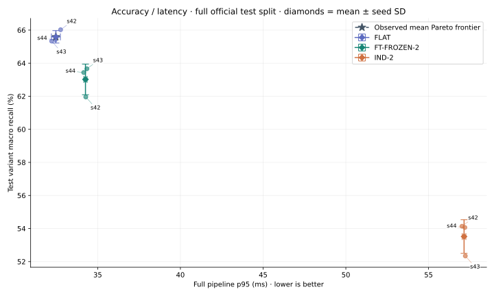

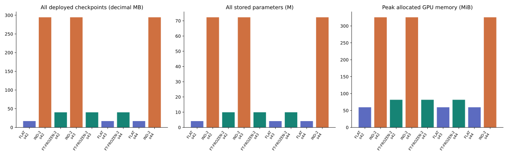

Generic ImageNet-frozen, three-stage and FP16 results are unmeasured in this primary publication. FP16 is a separately invocable deployment ablation using the same checkpoints.

## 3. Paired differences and engineering objective

FT-FROZEN-2 − IND-2 macro recall: **+9.50 pp**, paired 95% image-bootstrap CI **[+8.33, +10.60] pp**. Mean seed-p95 difference: **-22.88 ms**; reduction: **40.05%**.

Exploratory engineering thresholds: observed accuracy within 2 pp degradation: **yes**; observed p95 reduction ≥30%: **yes**. These observations are not a formal noninferiority claim.

Bootstrap: 2,000 replicates, RNG seed 6006, paired image resampling within every variant; use identical resampled IDs for both architectures and all fixed seeds, then average per-class differences across seeds. Percentile CI captures test-image uncertainty conditional on these checkpoints; training-seed population uncertainty and latency confidence intervals are not estimated.

## 4. Routing error attribution

| Architecture / seed | Hard macro recall (%) | Oracle diagnostic (%) | Oracle − hard (pp) |
| --- | ---: | ---: | ---: |
| FLAT / 42 | 66.02 | N/A | N/A |
| IND-2 / 42 | 54.14 | 64.09 | 9.95 |
| FT-FROZEN-2 / 42 | 61.96 | 76.91 | 14.95 |
| IND-2 / 43 | 52.34 | 63.51 | 11.17 |
| FT-FROZEN-2 / 43 | 63.66 | 77.00 | 13.34 |
| FLAT / 43 | 65.33 | N/A | N/A |
| FT-FROZEN-2 / 44 | 63.44 | 76.35 | 12.91 |
| FLAT / 44 | 65.42 | N/A | N/A |
| IND-2 / 44 | 54.06 | 64.37 | 10.31 |

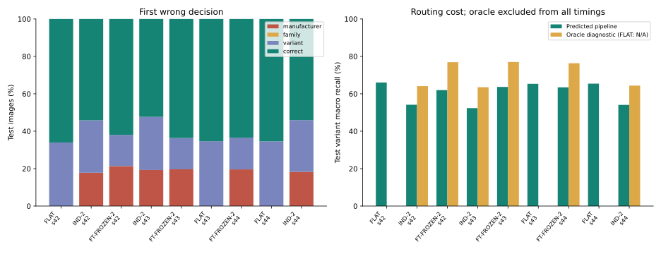

Oracle inference is a separate untimed diagnostic. Actual inference receives no labels. Two-stage routing has 17 trained variant specialists and 13 deterministic single-variant manufacturer branches; bypass rates are predicted-route frequencies. All manufacturer router and first-wrong-stage counts are retained in each metrics JSON.

## 5. Latency by actual executed path

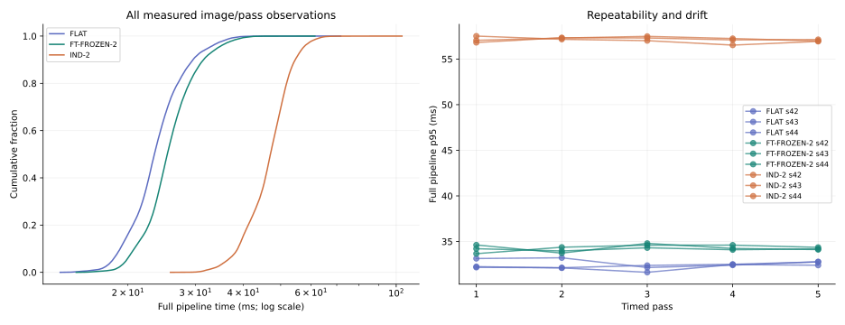

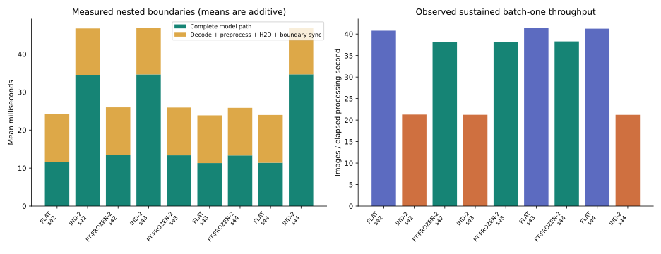

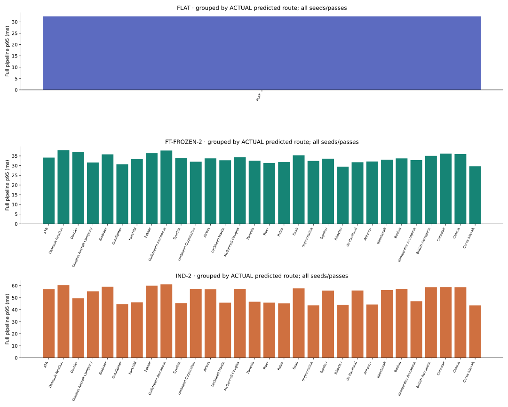

Per-image CSVs retain every pass, selected manufacturer route, classifier/backbone counts, singleton bypasses, conditional MACs and both latency boundaries. `timing_summary.json` contains p50/mean/p95/p99 for every observed route and pass. Stored inactive models count toward storage and residency, but not executed MACs.

## 6. Specialist update / introduction

Unmeasured; Phase 7 remains pending. This benchmark makes no introduced-class or update-cost claim.

## 7. Full networks and training-result review

Each schematic includes every trained specialist, all singleton branches, all 100 global variant labels, EfficientNet stage dimensions, and each specialist's selected epoch for all seeds. JSON inventories permit checking that the graph contains exactly the deployed nodes. Schematics show stored alternatives; only one branch executes.

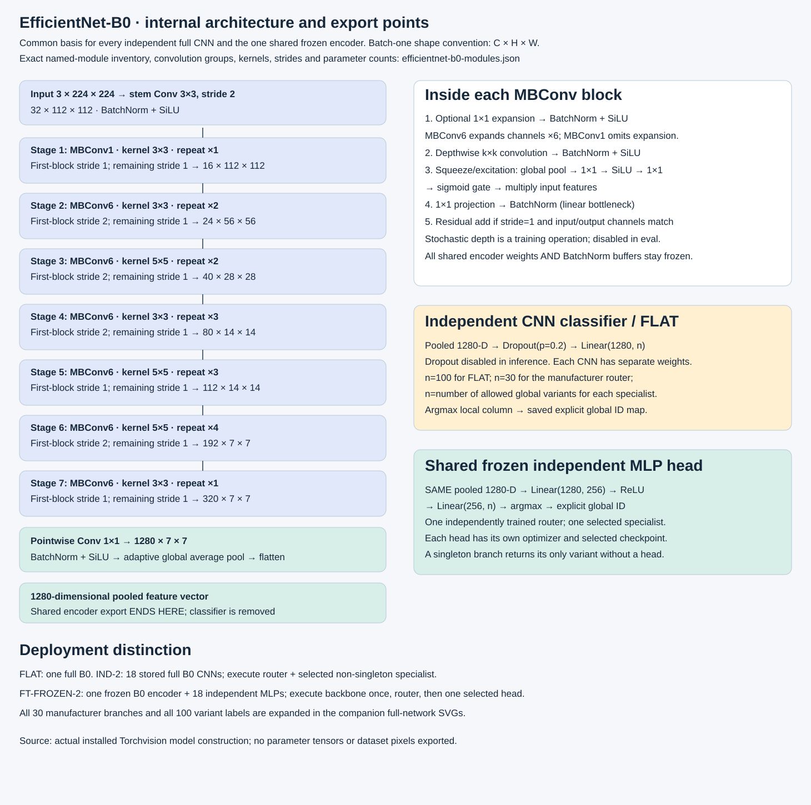

[Every actual Torchvision module, kernel, stride, convolution group and parameter count](efficientnet-b0-modules.json).

### FLAT

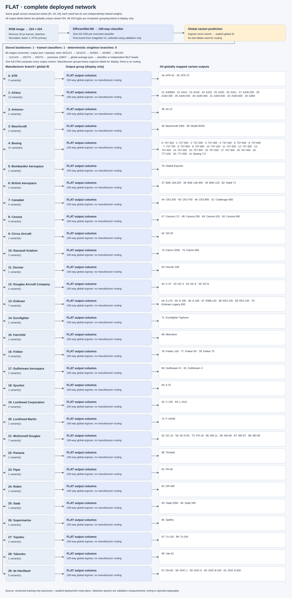

### FT-FROZEN-2

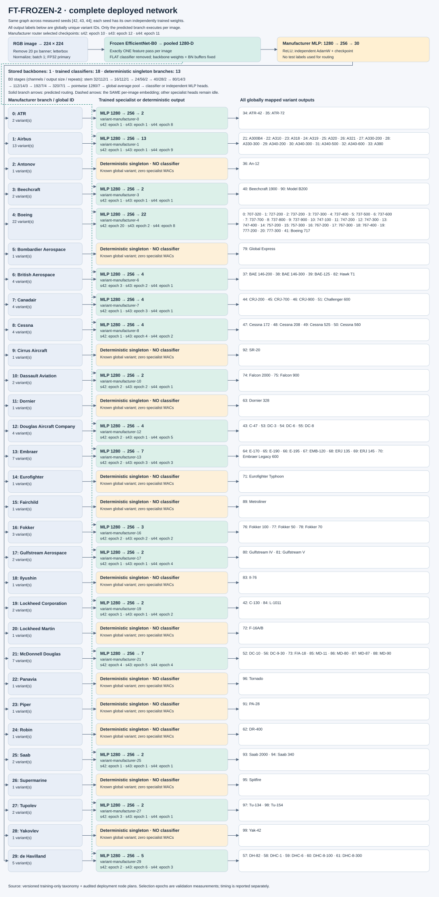

### IND-2

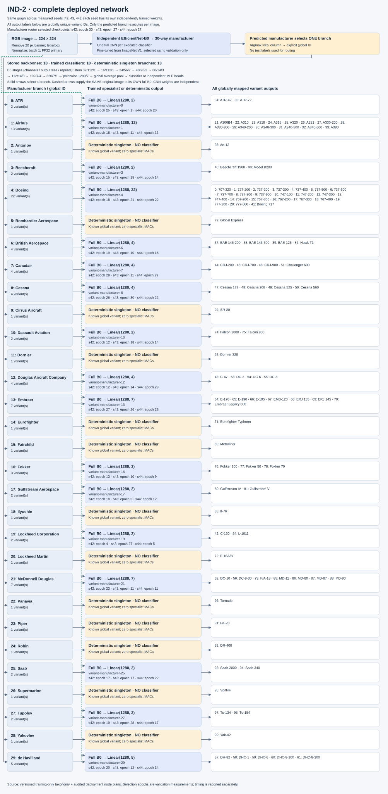

[All specialist selections and validation scores](specialist_inventory.csv); [full per-head training histories](specialist_training.json). FLAT learning curves and source-encoder checks remain in the [Phase 3 review](../../stage3/flat-20261025T045223Z-788dc5f4/REPORT.md).

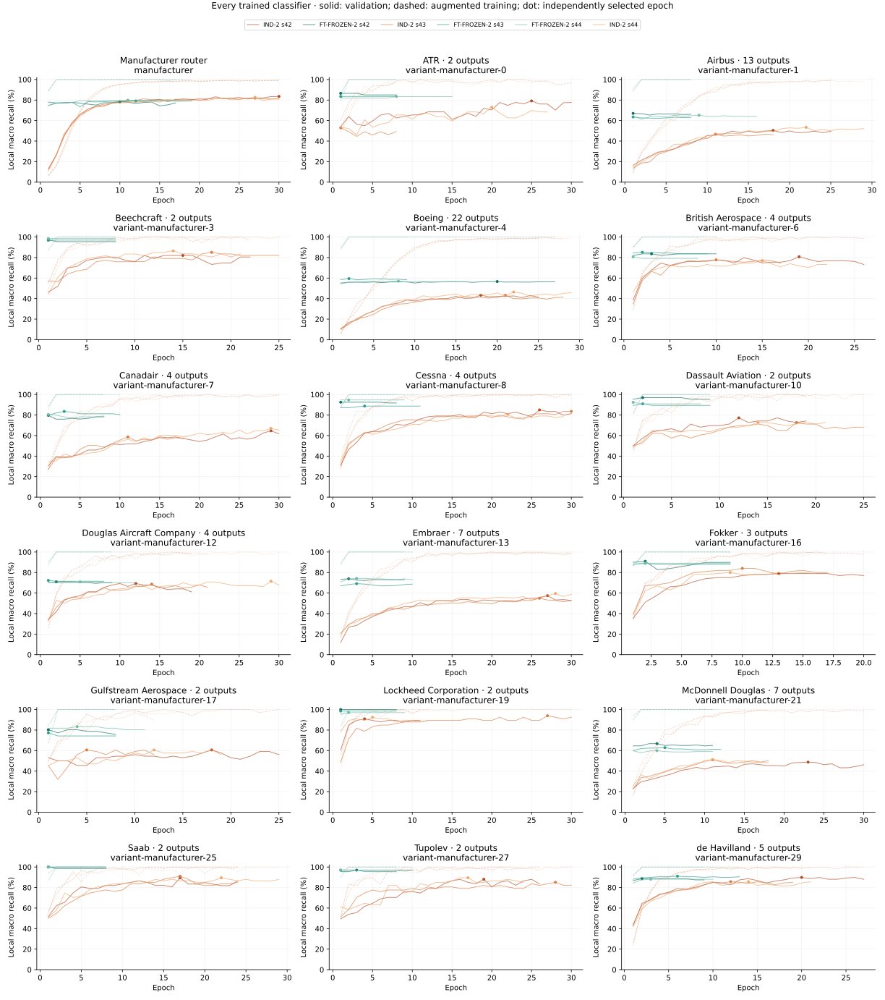

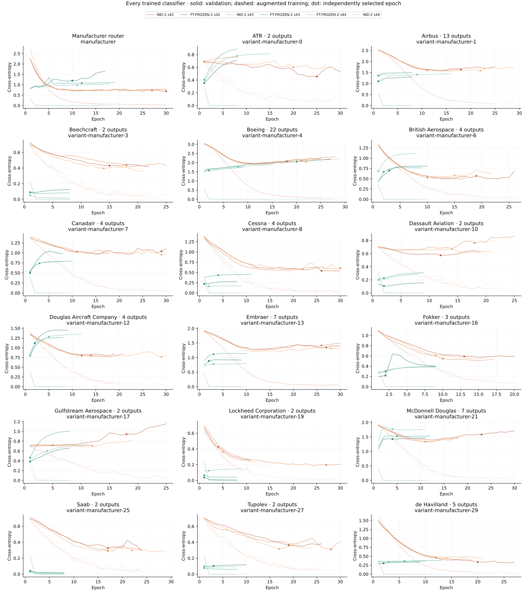

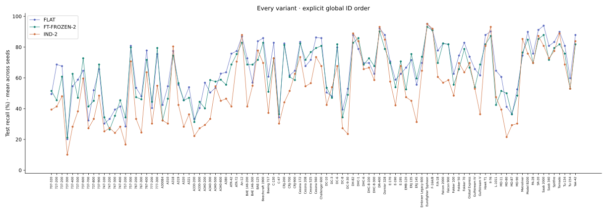

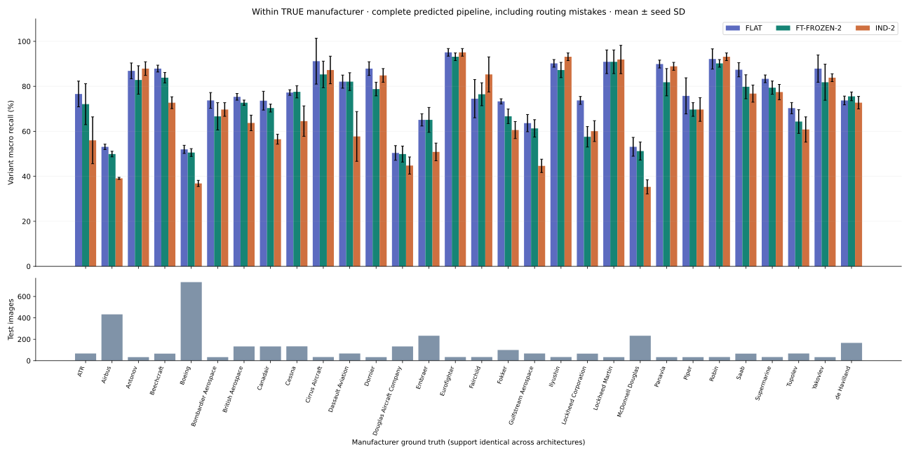

[Branch accuracy/support CSV](branch_accuracy.csv). Accuracy groups by true manufacturer and includes routing mistakes; latency groups by the actually predicted route. These have different denominators.

Confusion matrices are available per architecture and seed:

- [FLAT seed 42](confusion-FLAT-s42.svg)
- [IND-2 seed 42](confusion-IND-2-s42.svg)
- [FT-FROZEN-2 seed 42](confusion-FT-FROZEN-2-s42.svg)
- [IND-2 seed 43](confusion-IND-2-s43.svg)
- [FT-FROZEN-2 seed 43](confusion-FT-FROZEN-2-s43.svg)
- [FLAT seed 43](confusion-FLAT-s43.svg)
- [FT-FROZEN-2 seed 44](confusion-FT-FROZEN-2-s44.svg)
- [FLAT seed 44](confusion-FLAT-s44.svg)
- [IND-2 seed 44](confusion-IND-2-s44.svg)

## 8. Discussion and limits

**RQ1 (accuracy):** task-adapted shared heads change variant macro recall by +9.50 pp relative to independent cascades on these fixed checkpoints; the paired image interval is reported above.

**RQ2 (latency):** the shared pipeline changes mean seed-p95 latency by -22.88 ms (40.05% reduction) under the same full boundary and all-resident policy.

The FLAT sanity baseline reaches 65.59% macro recall at 32.47 ms mean seed-p95; the shared cascade reaches 63.02% at 34.26 ms. These baseline results are part of the accuracy/latency comparison. Specialist-update outcomes remain pending Phase 7.

**RQ3 (routing):** compare hard versus oracle rows and first-wrong-stage counts to isolate lost reachability from local discrimination. Oracle results are diagnostic and cannot be deployed. **RQ4 (updates)** and **RQ5 (generic versus adapted frozen features)** remain unmeasured.

The primary observations apply to the complete official FGVC test split on this GPU, preprocessing and residency policy. Routing errors, bypass frequency, all-model storage and conditional compute are exposed separately. Interactive desktop load, unlocked laptop clocks, normal filesystem caching, and nested synchronization limit portability of latency values. Adapter finite-value checks and per-call eval-mode maintenance are included, so latency reflects this deployed implementation as well as backbone arithmetic. Training costs are copied from audited training resources; task-adapted shared models additionally require their source FLAT training, recorded in `backbone_source.flat_resources`. Cumulative fitting time includes training and validation/selection; parallel work and total GPU activity are not inferred from wall time. These are completed-fit costs; discarded/interrupted training attempts remain documented in the [Phase 4 evidence](../../stage4/validation-20261027T071705Z-2b712381/REPORT.md) and are not added to this table. No equal-training-compute claim is made.

## 9. Reproduction and audit links

```powershell
.venv-cuda/Scripts/python.exe -m cls_balance.benchmark --config configs/benchmark.yaml
.venv-cuda/Scripts/python.exe -m cls_balance.report_benchmark --suite <completed-benchmark-suite> --output-root results/stage6
.venv/Scripts/python.exe scripts/freeze_tests.py --check
.venv/Scripts/python.exe -m pytest -q tests checks
```

The exact local checkpoint paths are in `configs/benchmark.yaml`; substitute your reproduced training run IDs. Set `precision: fp16` in a separate YAML for the optional separate precision pass. Models/data remain ignored. Rebuild training runs using the README sequence before benchmarking on another machine.

| Architecture / seed | Training run | Predictions | Timings | Metrics / resources |
| --- | --- | --- | --- | --- |
| FLAT / 42 | `flat-s42-20261025T031340Z-5385e556` | [CSV](bench-flat-s42-fp32-20261028T002835Z-ee443471/predictions_test.csv) | [CSV](bench-flat-s42-fp32-20261028T002835Z-ee443471/latency_test.csv) | [metrics](bench-flat-s42-fp32-20261028T002835Z-ee443471/metrics.json), [resources](bench-flat-s42-fp32-20261028T002835Z-ee443471/resources.json), [environment](bench-flat-s42-fp32-20261028T002835Z-ee443471/environment.json), [provenance](bench-flat-s42-fp32-20261028T002835Z-ee443471/provenance.json) |
| IND-2 / 42 | `ind-s42-20261026T125759Z-6d87251e` | [CSV](bench-ind-2-s42-fp32-20261028T003546Z-a7abe1e8/predictions_test.csv) | [CSV](bench-ind-2-s42-fp32-20261028T003546Z-a7abe1e8/latency_test.csv) | [metrics](bench-ind-2-s42-fp32-20261028T003546Z-a7abe1e8/metrics.json), [resources](bench-ind-2-s42-fp32-20261028T003546Z-a7abe1e8/resources.json), [environment](bench-ind-2-s42-fp32-20261028T003546Z-a7abe1e8/environment.json), [provenance](bench-ind-2-s42-fp32-20261028T003546Z-a7abe1e8/provenance.json) |
| FT-FROZEN-2 / 42 | `shared-ft-frozen-s42-20261027T140957Z-b392fc3a` | [CSV](bench-ft-frozen-2-s42-fp32-20261028T005145Z-77db98d3/predictions_test.csv) | [CSV](bench-ft-frozen-2-s42-fp32-20261028T005145Z-77db98d3/latency_test.csv) | [metrics](bench-ft-frozen-2-s42-fp32-20261028T005145Z-77db98d3/metrics.json), [resources](bench-ft-frozen-2-s42-fp32-20261028T005145Z-77db98d3/resources.json), [environment](bench-ft-frozen-2-s42-fp32-20261028T005145Z-77db98d3/environment.json), [provenance](bench-ft-frozen-2-s42-fp32-20261028T005145Z-77db98d3/provenance.json) |
| IND-2 / 43 | `ind-s43-20261026T141824Z-b8c12b2c` | [CSV](bench-ind-2-s43-fp32-20261028T010100Z-94b40e55/predictions_test.csv) | [CSV](bench-ind-2-s43-fp32-20261028T010100Z-94b40e55/latency_test.csv) | [metrics](bench-ind-2-s43-fp32-20261028T010100Z-94b40e55/metrics.json), [resources](bench-ind-2-s43-fp32-20261028T010100Z-94b40e55/resources.json), [environment](bench-ind-2-s43-fp32-20261028T010100Z-94b40e55/environment.json), [provenance](bench-ind-2-s43-fp32-20261028T010100Z-94b40e55/provenance.json) |
| FT-FROZEN-2 / 43 | `shared-ft-frozen-s43-20261027T142909Z-e9730962` | [CSV](bench-ft-frozen-2-s43-fp32-20261028T011700Z-0d6258ed/predictions_test.csv) | [CSV](bench-ft-frozen-2-s43-fp32-20261028T011700Z-0d6258ed/latency_test.csv) | [metrics](bench-ft-frozen-2-s43-fp32-20261028T011700Z-0d6258ed/metrics.json), [resources](bench-ft-frozen-2-s43-fp32-20261028T011700Z-0d6258ed/resources.json), [environment](bench-ft-frozen-2-s43-fp32-20261028T011700Z-0d6258ed/environment.json), [provenance](bench-ft-frozen-2-s43-fp32-20261028T011700Z-0d6258ed/provenance.json) |
| FLAT / 43 | `flat-s43-20261025T034152Z-d43e9130` | [CSV](bench-flat-s43-fp32-20261028T012609Z-34e191e9/predictions_test.csv) | [CSV](bench-flat-s43-fp32-20261028T012609Z-34e191e9/latency_test.csv) | [metrics](bench-flat-s43-fp32-20261028T012609Z-34e191e9/metrics.json), [resources](bench-flat-s43-fp32-20261028T012609Z-34e191e9/resources.json), [environment](bench-flat-s43-fp32-20261028T012609Z-34e191e9/environment.json), [provenance](bench-flat-s43-fp32-20261028T012609Z-34e191e9/provenance.json) |
| FT-FROZEN-2 / 44 | `shared-ft-frozen-s44-20261027T144302Z-c8142ff8` | [CSV](bench-ft-frozen-2-s44-fp32-20261028T013311Z-d37bc3f4/predictions_test.csv) | [CSV](bench-ft-frozen-2-s44-fp32-20261028T013311Z-d37bc3f4/latency_test.csv) | [metrics](bench-ft-frozen-2-s44-fp32-20261028T013311Z-d37bc3f4/metrics.json), [resources](bench-ft-frozen-2-s44-fp32-20261028T013311Z-d37bc3f4/resources.json), [environment](bench-ft-frozen-2-s44-fp32-20261028T013311Z-d37bc3f4/environment.json), [provenance](bench-ft-frozen-2-s44-fp32-20261028T013311Z-d37bc3f4/provenance.json) |
| FLAT / 44 | `flat-s44-20261025T041556Z-40c093b2` | [CSV](bench-flat-s44-fp32-20261028T014217Z-fe46e53d/predictions_test.csv) | [CSV](bench-flat-s44-fp32-20261028T014217Z-fe46e53d/latency_test.csv) | [metrics](bench-flat-s44-fp32-20261028T014217Z-fe46e53d/metrics.json), [resources](bench-flat-s44-fp32-20261028T014217Z-fe46e53d/resources.json), [environment](bench-flat-s44-fp32-20261028T014217Z-fe46e53d/environment.json), [provenance](bench-flat-s44-fp32-20261028T014217Z-fe46e53d/provenance.json) |
| IND-2 / 44 | `ind-s44-20261026T153237Z-2b462c75` | [CSV](bench-ind-2-s44-fp32-20261028T014922Z-845ce944/predictions_test.csv) | [CSV](bench-ind-2-s44-fp32-20261028T014922Z-845ce944/latency_test.csv) | [metrics](bench-ind-2-s44-fp32-20261028T014922Z-845ce944/metrics.json), [resources](bench-ind-2-s44-fp32-20261028T014922Z-845ce944/resources.json), [environment](bench-ind-2-s44-fp32-20261028T014922Z-845ce944/environment.json), [provenance](bench-ind-2-s44-fp32-20261028T014922Z-845ce944/provenance.json) |

Audit any copied run independently with `python -m cls_balance.benchmark --audit <run-directory>`. `publication.json` binds every published artifact by SHA256. Training and inference sources are versioned by per-run hashes. Published CSVs contain test labels/predictions and aggregate training histories; no training image IDs, aircraft images, embedding caches or checkpoint tensors are included.
