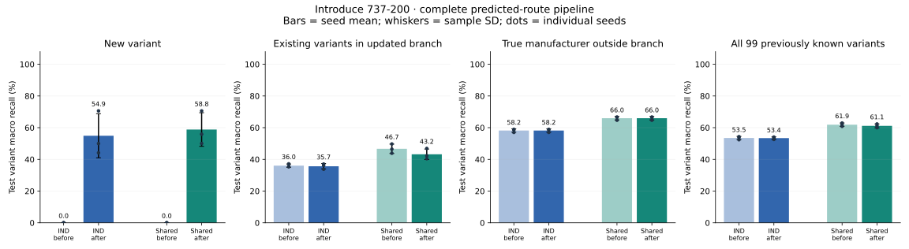
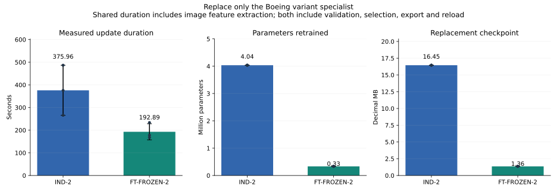
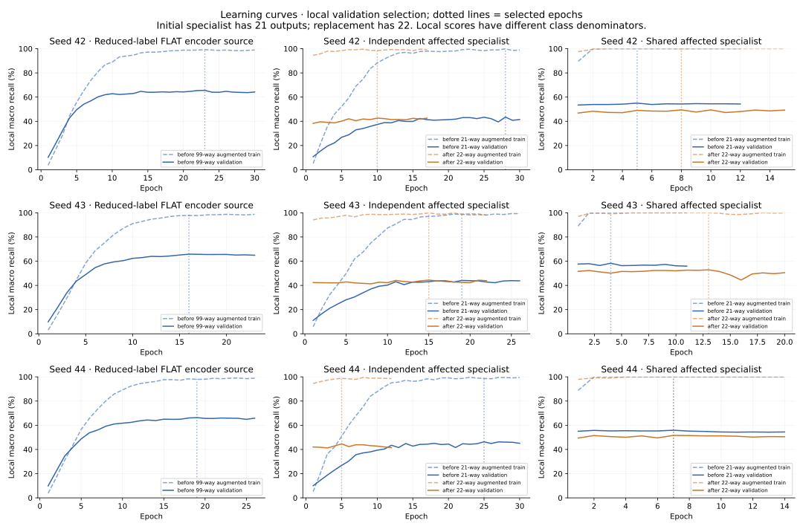
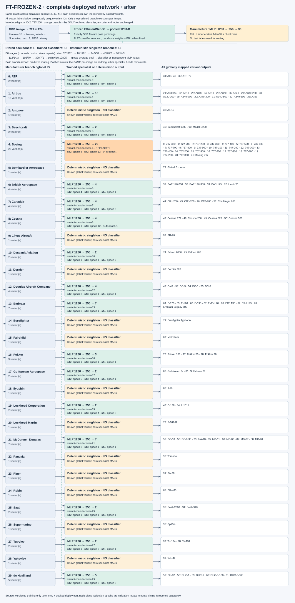

# Phase 7 — introduce 737-200 with one specialist replacement

Measured incremental experiment. Initial weights are trained afresh on 99 variants; the Phase 3–6 100-class encoders are never reused.

## Experimental context

| Field | Recorded value |
| --- | --- |
| Training run | `incremental-20261029T040144Z-860727e6` |
| Test evaluation run | `incremental-evaluation-20261029T093143Z-069c1926` |
| Training git SHA | `874ad610741876f84c7dfcbde098b82b86115f21`; dirty=True; exact source hashes included |
| Config hash | `b1916001293ca6b5389c49329dd6a4a87e6a6f7215bda4fe14caae5537febe71` |
| Dataset / taxonomy hash | `27a7dd09275ac80cee1769b5fd7d5f28fe29feaeb54d955b16cb3ce227500253` / `a79cf6f7fe8a7a028c1f2b51619b307750a241c26d863c0fc983423a6dd48177` |
| Preprocessing hash | `173fd93e7491bb9048ffe5257c364450fa69b3f0e1ac4b1a4cf965eddea78adc` |
| Edition / official splits | Torchvision 100 variants / 70 families / 30 manufacturers; 3334 / 3333 / 3333 |
| Seeds | [42, 43, 44] |
| Hardware / framework | NVIDIA GeForce RTX 3060 Laptop GPU; torch 2.9.1+cu128; CUDA 12.8 |
| Driver | NVIDIA GeForce RTX 3060 Laptop GPU, 621.01 |
| Precision / input / residency | FP32; 224×224; all resident; batch-one test inference; TF32 disabled |
| Power | OS/driver defaults; clocks not locked; temporary process-lifetime idle-sleep request |

## Predeclared introduction protocol

Selection: **lowest training-taxonomy global variant ID in a manufacturer with >=3 variants and a family with >=2 variants**. This selects global ID **2 (737-200)**, manufacturer **Boeing**.

The manufacturer initially retains 21 variants, and the held-out variant's family retains existing variants. All of its train **and validation** images are absent from initial FLAT fine-tuning, manufacturer training, independent specialist training, shared head fitting and every initial checkpoint selection. The initial shared encoder is exported only from that seed's new 99-way FLAT checkpoint.

The introduction adds the class's official training examples to the affected specialist, replaying all existing branch training examples. Only the corresponding validation branch is used for early stopping. Both architectures warm-start existing feature/head tensors and output rows; a new output row is seeded deterministically. The independent update optimizes the affected full CNN; the shared update optimizes only its MLP. Routers, shared encoder and every other specialist retain their exact bytes.

**Explicit implementation choices:** Active initial labels are a 99-ID mask over the canonical 100-ID taxonomy, preserving global IDs instead of renumbering. All test inference occurs only after every seed's before/after checkpoint has been selected. Before-stage headline accuracy below uses the 99 known classes. Retrospective all-100 and new-class-before scores are diagnostics; new-class recall is necessarily zero before its output exists. Every evaluation still retains the complete official test set, with no hidden subset benchmark.

## Specialist update / introduction (predicted full pipeline)

Values are seed mean ± sample SD. Macro recall is mean class recall; outside-branch micro accuracy is also given below. These are classification/update measurements, with no new inference-latency claim.

| Metric | IND-2 | FT-FROZEN-2 |
| --- | --- | --- |
| New-class recall, before (%) | 0.00 ± 0.00 | 0.00 ± 0.00 |
| New-class recall, after (%) | 54.90 ± 13.90 | 58.82 ± 10.60 |
| Existing updated-branch macro recall, before (%) | 36.04 ± 1.02 | 46.68 ± 2.94 |
| Existing updated-branch macro recall, after (%) | 35.67 ± 1.69 | 43.20 ± 3.32 |
| Outside true branch macro recall, before (%) | 58.20 ± 1.05 | 65.97 ± 1.11 |
| Outside true branch macro recall, after (%) | 58.20 ± 1.05 | 65.97 ± 1.11 |
| All 99 known variants macro recall, before (%) | 53.50 ± 1.00 | 61.88 ± 1.06 |
| All 99 known variants macro recall, after (%) | 53.42 ± 0.77 | 61.14 ± 1.20 |
| All 100 variants macro recall (before diagnostic), before (%) | 52.96 ± 0.99 | 61.26 ± 1.05 |
| All 100 variants macro recall (before diagnostic), after (%) | 53.43 ± 0.77 | 61.11 ± 1.29 |
| Outside true branch micro accuracy, before (%) | 58.21 ± 1.04 | 65.99 ± 1.10 |
| Outside true branch micro accuracy, after (%) | 58.21 ± 1.04 | 65.99 ± 1.10 |
| Update wall time (s) | 375.96 ± 110.42 | 192.89 ± 35.50 |
| Parameters retrained (M) | 4.04 ± 0.00 | 0.33 ± 0.00 |
| Replacement checkpoint (decimal MB) | 16.45 ± 0.00 | 1.36 ± 0.00 |
| Initial fitting wall time including encoder source (h) | 1.11 ± 0.06 | 0.56 ± 0.05 |

Update duration includes image feature extraction for the shared system, epoch optimization, validation, checkpoint selection, export and exact reload. Model initialization/loading and test inference are excluded. Replay/training exposure and step counts are in the per-seed resources JSONs. Validation-only selected epochs and complete learning curves are preserved.




## Per-seed results and routing diagnostics

| Seed / architecture | New recall after (%) | Old branch before → after (%) | Outside before → after (%) | Oracle new recall after (%) | Update (s) | Changed outside true branch |
| --- | --- | --- | --- | --- | --- | --- |
| 42 / IND-2 | 70.59 | 37.20 → 33.78 | 58.93 → 58.93 | 73.53 | 375.40 | 71 |
| 42 / FT-FROZEN-2 | 70.59 | 49.74 → 46.88 | 66.49 → 66.49 | 76.47 | 177.55 | 72 |
| 43 / IND-2 | 50.00 | 35.29 → 36.18 | 56.99 → 56.99 | 58.82 | 486.65 | 59 |
| 43 / FT-FROZEN-2 | 50.00 | 46.43 → 42.28 | 64.70 → 64.70 | 58.82 | 233.47 | 71 |
| 44 / IND-2 | 44.12 | 35.62 → 37.04 | 58.67 → 58.67 | 50.00 | 265.82 | 46 |
| 44 / FT-FROZEN-2 | 55.88 | 43.87 → 40.43 | 66.71 → 66.71 | 76.47 | 167.64 | 44 |

The manufacturer router produces identical before/after decisions. Every image routed outside the affected manufacturer has an identical complete prediction. Images whose **true** manufacturer lies outside Boeing can still change when the fixed router mistakenly selects Boeing; the count is measured above. Unchanged module bytes alone do not justify assuming unchanged outside-class accuracy.

Oracle routing is a named diagnostic only. Every nested evaluation retains full routing diagnostics, per-class recall, confusion matrix, bypass counts and per-image path decisions. Hard-route and oracle scores are never pooled.

## Training review and complete architectures



[Validation curves for every trained router and specialist](plots/every-specialist-validation.svg). Every selected classifier's full aggregate train/validation history is linked from `nodes.json`.

The diagrams expand **all 30 manufacturer branches**, every trained specialist, all active global variant outputs, singleton bypasses, and per-seed selected epochs. Only the predicted branch executes. Orange marks the replacement; the other nodes remain unchanged.

| Network | Before | After |
| --- | --- | --- |
| IND-2, 18 separate full CNNs | [99-class network](plots/before/network-IND-2.svg) | [100-class network](plots/after/network-IND-2.svg) |
| FT-FROZEN-2, one encoder + 18 independent heads | [99-class network](plots/before/network-FT-FROZEN-2.svg) | [100-class network](plots/after/network-FT-FROZEN-2.svg) |
| Initial FLAT encoder source | [99-way classifier](plots/before/network-FLAT.svg) | No FLAT update; used only to export the initial encoder |



[EfficientNet-B0 layer detail](plots/efficientnet-b0-detail.svg) · [every variant's before/after recall](plots/all-variant-recalls.svg) · [classwise CSV](classwise-before-after.csv) · [checkpoint and node inventory](nodes.json).

## Audits, interpretation and limits

The training audit re-derives each node's exact supervised IDs from official train/validation annotations; checks initial holdout exclusion, encoder parent, seed/config/data/preprocessing hashes, local-to-global maps, earliest best validation epoch, and per-epoch support. Checkpoint reloads are exact. Unrelated weights/buffers, encoder and fixed-input logits are checked before publication; no test image enters optimization or selection.

The result tests one deterministic class introduction on one dataset/hardware configuration. With roughly 33 test examples per class, new-class recall has limited resolution. Seed SD describes training variability and is not a confidence interval. No post-test hyperparameter changes or class reselection are permitted. Broader paired-bootstrap inference and Phase 8 publication remain separate.

The primary Phase 6 latency comparison is unchanged. Update duration is measured separately from inference latency and cannot be interpreted as FPS. Shared update cost excludes the already paid initial FLAT fine-tuning, which is retained separately in initial-cost metadata. Initial fitting scopes differ slightly (independent node epochs exclude export; reduced FLAT includes export/reload), and initial seed-42 backbone training overlapped CPU checks. Initial-cost totals are accounting evidence, not a controlled training-speed claim.

## Reproduction and artifact trace

```powershell
.venv-cuda/Scripts/python.exe scripts/train_incremental_awake.py train --config configs/incremental.yaml
.venv-cuda/Scripts/python.exe scripts/train_incremental_awake.py evaluate --suite runs/incremental/incremental-20261029T040144Z-860727e6
.venv-cuda/Scripts/python.exe -m cls_balance.report_incremental --training runs/incremental/incremental-20261029T040144Z-860727e6 --evaluation runs/incremental/incremental-evaluation-20261029T093143Z-069c1926 --output-root results/stage7
.venv/Scripts/python.exe -m pytest -q tests checks
```

Every table value is reproducible from [aggregate.json](aggregate.json), [evaluations.json](evaluations.json), per-test-image CSVs under `evaluations/`, and per-seed update resource files. [Training audit](training_audit.json), [functional audit](functional_audit.json), exact source hashes, configuration, environment and publication checksums are included. Weights, caches, training IDs and dataset images are excluded.
