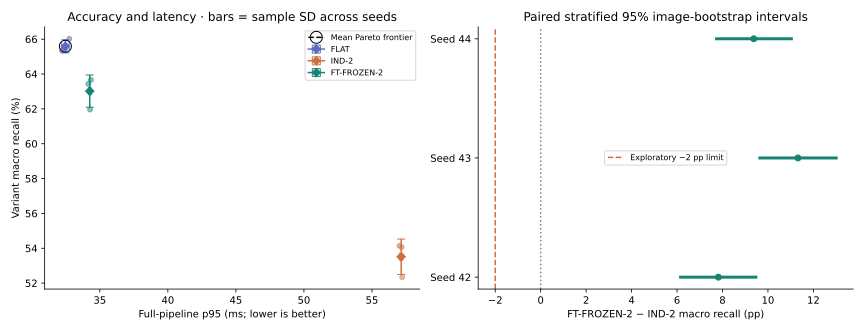
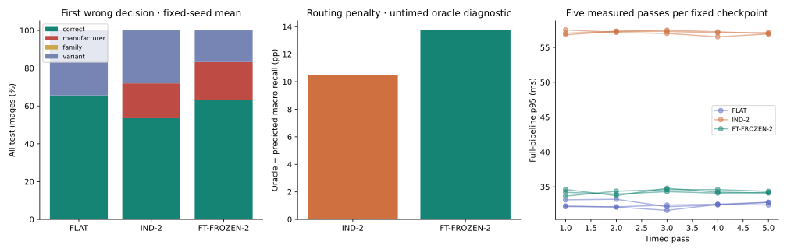
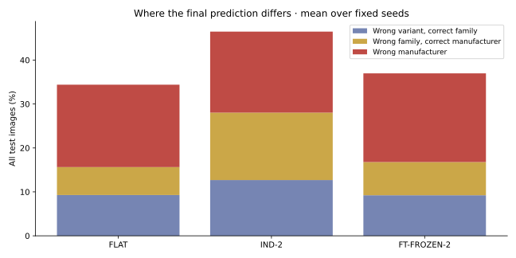
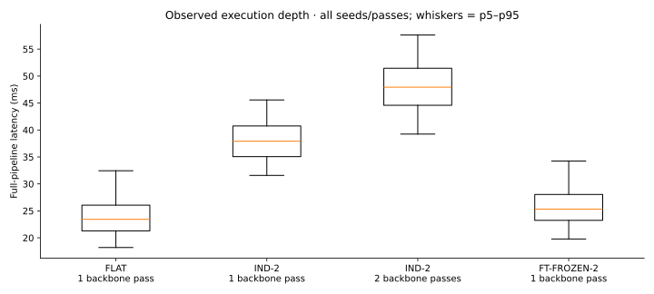
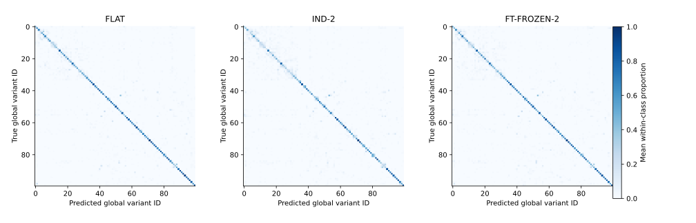

# FGVC-Aircraft — measured results

## 1. Experimental context

Primary study: FLAT, IND-2 and FT-FROZEN-2, seeds **42/43/44**, all **3,333 official test images**. Phase 8 reuses the completed frozen Phase 3–7 runs; it performs no fitting, inference or test-based model selection.

| Field | Recorded value |
| --- | --- |
| Analysis date / source commit | 2026-10-31T11:26:17.874162+00:00; `283579cc5ba3497c0095d45f41be23b5686212ee`; exact analysis source hashes in provenance.json |
| Dataset | Torchvision 100 variants / 70 families / 30 manufacturers; train/val/test 3334/3333/3333 |
| Dataset manifest SHA256 | `27a7dd09275ac80cee1769b5fd7d5f28fe29feaeb54d955b16cb3ce227500253`; individual split hashes in linked data contracts |
| Taxonomy SHA256 | `a79cf6f7fe8a7a028c1f2b51619b307750a241c26d863c0fc983423a6dd48177` |
| Preprocessing SHA256 | `173fd93e7491bb9048ffe5257c364450fa69b3f0e1ac4b1a4cf965eddea78adc` |
| Runtime framework / driver / GPU | PyTorch 2.9.1+cu128; CUDA 12.8; cuDNN 91002; NVIDIA GeForce RTX 3060 Laptop GPU, 621.01 |
| Analysis configuration SHA256 | `b8f6df48f3aabad078137600a33e17cadf0c8a513c538e408e60a4b384046465` |
| Precision / residency | FP32; batch 1; all deployment weights GPU resident; no inference embedding cache |
| Power regime | Interactive Windows laptop; driver/OS clocks unlocked; per-pass telemetry retained; ambient temperature unmeasured |

Preprocessing removes the bottom 20 px, bicubic letterboxes the complete remaining image to 224×224 with black padding, then applies ImageNet V1 normalization. All architectures share data, EfficientNet-B0 initialization family, preprocessing, device and measurement boundaries. Training uses AdamW, a 30-epoch cap, patience 7 and validation macro-recall checkpoint selection. Full CNN LR 1e-4; head LR 1e-3; shared MLP width 256. Resolved per-run configurations are authoritative.

**Full pipeline:** file open/decode + banner removal/letterbox/normalization + dtype/H2D + H2D sync + predicted adapter + D2H/Python global ID + completion sync; OS file cache retained.

**Model path:** ready device tensor through complete predicted adapter, D2H/Python ID and completion sync. **FPS:** continuous timed-pass loop including decode, preprocessing, transfers, inference, synchronization, timing instrumentation and in-memory result collection; excludes CSV writes, telemetry, setup, warmup and oracle.

Warmup covers every trained node 32 times and label-free predicted routes. Timers synchronize CUDA. The benchmark has five full passes per checkpoint (149,985 image timings). Oracle routing is a separate untimed diagnostic.

**Protocol deviations and scope:** no new primary experiment settings were selected in Phase 8. Generic ImageNet-frozen, three-stage, and FP16 results are unmeasured follow-ups. Initial incremental systems preserve global IDs through a 99-class active mask; the held-out family retains another variant. Archive checksum discrepancies, interruptions and discarded attempts remain documented in the earlier phase evidence.

## 2. Main comparison

Mean ± sample SD across seeds. Latency percentiles pool all 5×3,333 observations within each seed, then report mean ± SD of seed percentiles. FPS divides observed image counts by elapsed processing time. MB is decimal; MiB is binary. MACs count executed Conv2d/Linear multiply-accumulates only.

| Metric | FLAT | IND-2 | FT-FROZEN-2 |
| --- | ---: | ---: | ---: |
| Variant macro recall (%) | 65.59 ± 0.37 | 53.51 ± 1.02 | 63.02 ± 0.93 |
| Variant top-1 (%) | 65.61 ± 0.38 | 53.53 ± 1.01 | 63.03 ± 0.93 |
| Variant macro-F1 (%) | 65.28 ± 0.51 | 53.48 ± 1.08 | 63.11 ± 1.03 |
| Manufacturer accuracy from final variant (%) | 81.25 ± 0.53 | 81.56 ± 0.75 | 79.81 ± 1.01 |
| Family accuracy from final variant (%) | 74.89 ± 0.23 | 66.22 ± 1.10 | 72.26 ± 0.81 |
| Oracle variant macro recall (%) | N/A | 63.99 ± 0.44 | 76.75 ± 0.35 |
| First-stage routing accuracy (%) | N/A | 81.56 ± 0.75 | 79.81 ± 1.01 |
| Full-pipeline p50 (ms) | 23.44 ± 0.19 | 47.02 ± 0.07 | 25.33 ± 0.06 |
| Full-pipeline mean (ms) | 24.03 ± 0.20 | 46.82 ± 0.08 | 25.92 ± 0.07 |
| **Full-pipeline p95 (ms)** | 32.47 ± 0.27 | 57.15 ± 0.11 | 34.26 ± 0.10 |
| Full-pipeline p99 (ms) | 36.91 ± 0.24 | 62.49 ± 0.22 | 39.06 ± 0.14 |
| Model-path p95 (ms) | 13.95 ± 0.07 | 41.37 ± 0.03 | 16.85 ± 0.07 |
| Continuous throughput (FPS) | 41.15 ± 0.33 | 21.24 ± 0.03 | 38.19 ± 0.10 |
| Peak GPU allocated memory (MiB) | 59.54 ± 0.00 | 325.51 ± 0.00 | 81.69 ± 0.00 |
| Deployment checkpoint storage (MB) | 16.94 ± 0.00 | 294.43 ± 0.00 | 40.31 ± 0.00 |
| All model parameters (M) | 4.14 ± 0.00 | 72.29 ± 0.00 | 9.94 ± 0.00 |
| Mean executed MACs/image (G) | 0.38 ± 0.00 | 0.72 ± 0.00 | 0.39 ± 0.00 |
| Mean executed backbone calls | 1.00 ± 0.00 | 1.87 ± 0.00 | 1.00 ± 0.00 |
| Singleton-bypass images (%) | 0.00 ± 0.00 | 12.90 ± 0.32 | 12.33 ± 0.24 |
| Cumulative fitting wall time incl. source FLAT (h) | 0.48 ± 0.06 | 1.22 ± 0.07 | 0.69 ± 0.01 |
| Optimizer steps incl. source FLAT | 5852.00 ± 724.00 | 11028.00 ± 325.10 | 11825.00 ± 637.81 |
| Training-image exposures incl. source FLAT | 93352.00 ± 11549.31 | 171808.33 ± 4917.15 | 186979.00 ± 10077.05 |

FROZEN-2 / IND-3 / FT-FROZEN-3 / FROZEN-3: **unmeasured**. Shared cost includes its seed-matched source FLAT fitting. Training hours are elapsed fitting/validation/selection time on the recorded GPU, not independently instrumented GPU activity or equal-compute budgets.

## 3. Paired differences, uncertainty and engineering objective

| Fixed seed | Δ macro recall, shared − independent (pp) | Paired 95% bootstrap CI (pp) |
| --- | ---: | --- |
| 42 | +7.82 | [+6.16, +9.47] |
| 43 | +11.32 | [+9.64, +13.00] |
| 44 | +9.37 | [+7.74, +11.03] |

Across the three fixed seed pairs, mean difference **+9.50 pp**; sample SD of differences **1.75 pp**. The descriptive fixed-seed-mean image interval is [+8.38, +10.64] pp.

Bootstrap uses 10,000 replicates, NumPy RNG seed 8008, paired IDs sampled with replacement separately within each true variant, preserved class support and equal class weights. Each per-seed interval holds that model pair fixed. The fixed-seed mean uses identical image draws across the pairs; it does not treat seed/image combinations as independent observations. These intervals describe test-image sampling uncertainty, not uncertainty over future training seeds.

Mean seed-p95 difference: **-22.88 ms**; reduction **40.05%**. Exploratory engineering checks: ≤2 pp observed degradation: **True**; ≥30% observed p95 reduction: **True**; every fixed-pair accuracy CI lower bound ≥−2 pp: **True**. This is not a formal noninferiority study, and no latency population confidence interval is claimed. Five-pass min/max/SD and every pass percentile are retained in the CSVs to expose repeatability.



Mean accuracy–latency Pareto frontier among measured systems: **FLAT**. FLAT has higher recall and lower p95 than either measured hierarchy; the modular update question is a separate benefit/cost axis. No model was selected using this frontier.

## 4. Routing error attribution

| Architecture / seed | Manufacturer router (%) | Hard macro recall (%) | Oracle macro recall (%) | Oracle − hard (pp) |
| --- | ---: | ---: | ---: | ---: |
| IND-2 / 42 | 82.21 | 54.14 | 64.09 | 9.95 |
| IND-2 / 43 | 80.74 | 52.34 | 63.51 | 11.17 |
| IND-2 / 44 | 81.73 | 54.06 | 64.37 | 10.31 |
| FT-FROZEN-2 / 42 | 78.64 | 61.96 | 76.91 | 14.95 |
| FT-FROZEN-2 / 43 | 80.38 | 63.66 | 77.00 | 13.34 |
| FT-FROZEN-2 / 44 | 80.41 | 63.44 | 76.35 | 12.91 |



First-wrong-stage proportions use all test images per seed, counting manufacturer errors before downstream variant errors. For FLAT, mistakes are assigned to its single variant decision. Two-stage systems have no family router, so conditional family-router accuracy is N/A. There are 17 trained variant specialists and 13 deterministic single-variant manufacturer branches. Bypass rates above use actual predicted routes. Within-family, cross-family within manufacturer and cross-manufacturer error counts are mutually exclusive and available in family_error_breakdown.csv.



## 5. Latency by path

| Architecture / seed | Executed backbone calls | Distinct test images | Observations | p50 (ms) | p95 (ms) |
| --- | ---: | ---: | ---: | ---: | ---: |
| FLAT / 42 | 1 | 3333 | 16665 | 23.66 | 32.76 |
| FLAT / 43 | 1 | 3333 | 16665 | 23.31 | 32.22 |
| FLAT / 44 | 1 | 3333 | 16665 | 23.36 | 32.44 |
| IND-2 / 42 | 1 | 427 | 2135 | 37.92 | 45.56 |
| IND-2 / 42 | 2 | 2906 | 14530 | 47.87 | 57.54 |
| IND-2 / 43 | 1 | 421 | 2105 | 37.78 | 45.72 |
| IND-2 / 43 | 2 | 2912 | 14560 | 47.90 | 57.69 |
| IND-2 / 44 | 1 | 442 | 2210 | 37.98 | 45.41 |
| IND-2 / 44 | 2 | 2891 | 14455 | 48.05 | 57.69 |
| FT-FROZEN-2 / 42 | 1 | 3333 | 16665 | 25.37 | 34.28 |
| FT-FROZEN-2 / 43 | 1 | 3333 | 16665 | 25.35 | 34.35 |
| FT-FROZEN-2 / 44 | 1 | 3333 | 16665 | 25.26 | 34.15 |



[Every predicted manufacturer branch p50/p95](branch_latency.csv); [per-pass repeatability](pass_latency.csv); [original per-branch graph](../../../results/stage6/benchmark-20261028T022812Z-fa52c222/branch-latency.svg). Latency groups by predicted route; accuracy/support groups by true manufacturer and includes routing mistakes. Path-specific GPU peaks were not measured: only per-run peaks appear above. All stored independent models count toward residency/storage even when idle. Cold start, cold filesystem cache and separate preprocessing/backbone/router/transfer component timers are unmeasured. The full and model-path boundaries are nested; their mean difference includes preprocessing, transfer and extra synchronization, not an isolated component profile.

## 6. Specialist update / introduction

Initial systems know 99 variants. Boeing 737-200 (global ID 2) was chosen using training taxonomy only and excluded from initial train/validation for **every initial backbone and specialist**. After introduction, only the affected Boeing specialist is retrained with new-class training examples and existing-class replay; validation selects the replacement. The manufacturer router, shared backbone and unrelated heads retain their parameters and functional logits. No extra dataset is used.

| Metric | Independent cascade | Shared frozen backbone |
| --- | ---: | ---: |
| New-class recall after (%) | 54.90 ± 13.90 | 58.82 ± 10.60 |
| Old Boeing-class macro recall before (%) | 36.04 ± 1.02 | 46.68 ± 2.94 |
| Old Boeing-class macro recall after (%) | 35.67 ± 1.69 | 43.20 ± 3.32 |
| Outside-branch accuracy before (%) | 58.21 ± 1.04 | 65.99 ± 1.10 |
| Outside-branch accuracy after (%) | 58.21 ± 1.04 | 65.99 ± 1.10 |
| Update wall time (s) | 375.96 ± 110.42 | 192.89 ± 35.50 |
| Parameters retrained | 4035730.00 ± 0.00 | 333590.00 ± 0.00 |
| Replacement checkpoint (MB) | 16.45 ± 0.00 | 1.36 ± 0.00 |

[Full measured update report, per-image before/after predictions, costs and checksum audits](../../../results/stage7/incremental-20261029T102022Z-dd4acc20/REPORT.md). Update time includes shared feature extraction, fitting, selection, export and reload, excluding initialization/loading. This is a separately trained reduced-label experiment; its results must not be mixed with the 100-class primary systems. Unchanged outside-branch accuracy does not imply every wrong label is unchanged for images incorrectly routed into Boeing.

## 7. Plots to publish



- [Per-seed confusion matrices and every class recall](../../../results/stage6/benchmark-20261028T022812Z-fa52c222/REPORT.md#7-full-networks-and-training-result-review).
- [Every specialist learning curve](../../../results/stage6/benchmark-20261028T022812Z-fa52c222/all-specialist-macro_recall.svg) and [loss curve](../../../results/stage6/benchmark-20261028T022812Z-fa52c222/all-specialist-loss.svg).
- [Per-class recall](../../../results/stage6/benchmark-20261028T022812Z-fa52c222/class-recall.svg), [branch support](../../../results/stage6/benchmark-20261028T022812Z-fa52c222/branch-accuracy-support.svg), [storage and GPU memory](../../../results/stage6/benchmark-20261028T022812Z-fa52c222/storage-memory.svg).
- [Complete independent network](../../../results/stage6/benchmark-20261028T022812Z-fa52c222/network-IND-2.svg), [shared network](../../../results/stage6/benchmark-20261028T022812Z-fa52c222/network-FT-FROZEN-2.svg), [EfficientNet internals](../../../results/stage6/benchmark-20261028T022812Z-fa52c222/efficientnet-b0-detail.svg).
- [Incremental cost, before/after accuracy and training plots](../../../results/stage7/incremental-20261029T102022Z-dd4acc20/REPORT.md).

All graphics derive from measured numeric artifacts or exact network topology. No generated aircraft pictures are required for interpreting the results.

## 8. Discussion and conclusion

**RQ1 — Accuracy:** FT-FROZEN-2 exceeds IND-2 on each fixed seed pair, while FLAT achieves the highest measured variant macro recall. The per-seed paired intervals quantify image-sampling uncertainty; three seeds do not establish a population-of-training-seeds guarantee.

**RQ2 — Latency:** one shared backbone reduces the hierarchical pipeline p95 under the same all-resident FP32 boundary. FLAT remains faster than the shared hierarchy. Differences include this implementation's routing, finite-value checks, eval-mode maintenance and synchronization overhead.

**RQ3 — Routing error:** oracle gaps and first-wrong-stage counts expose lost reachability as well as residual within-branch discrimination. Oracle diagnostics are not deployable accuracy. Singleton bypass frequencies depend on the taxonomy and learned router.

**RQ4 — Modularity:** both approaches replace only one specialist with audited unchanged unrelated parameters. The shared replacement is cheaper here but loses more recall on existing Boeing classes. Outside-branch accuracy is measured unchanged.

**RQ5 — Feature suitability:** generic ImageNet-frozen ablations remain unmeasured, so these results cannot isolate the gain from adapting the encoder before freezing.

Claims apply to this official FGVC-Aircraft edition, 224×224 preprocessing, EfficientNet-B0, three seeds and one GPU/residency policy. They do not establish generality to other datasets, larger models, hardware, class introductions or equal training-compute budgets. Laptop clocks/load, caching, only five timing passes, small class test supports and unmeasured cold-start/component times limit deployment extrapolation.

## 9. Reproduction commands and audit links

Follow the single **Reproduce the complete study** sequence in the repository README. The analysis commands run entirely from committed test evidence:

```powershell
.venv-cuda/Scripts/python.exe -m cls_balance.report_analysis --config configs/analysis.yaml
.venv-cuda/Scripts/python.exe -m cls_balance.report_analysis --audit <phase8-review-directory>
.venv-cuda/Scripts/python.exe -m cls_balance.report_analysis --rebuild <phase8-review-directory> --output .tmp/rebuilt-phase8
```

| Architecture / seed | Training run / selected checkpoint identity | Config SHA256 | Test artifacts |
| --- | --- | --- | --- |
| FLAT / 42 | `flat-s42-20261025T031340Z-5385e556` / `49f5c459b510585e379463110e90bf8fb6de4907242105de362bc796ba0fded6` | `ec1d5b822d8d9aee78697f836440ca8a8a2ea01564a708b233f804d2289c608f` | [predictions](../../../results/stage6/benchmark-20261028T022812Z-fa52c222/bench-flat-s42-fp32-20261028T002835Z-ee443471/predictions_test.csv), [timings](../../../results/stage6/benchmark-20261028T022812Z-fa52c222/bench-flat-s42-fp32-20261028T002835Z-ee443471/latency_test.csv), [metrics](../../../results/stage6/benchmark-20261028T022812Z-fa52c222/bench-flat-s42-fp32-20261028T002835Z-ee443471/metrics.json), [provenance](../../../results/stage6/benchmark-20261028T022812Z-fa52c222/bench-flat-s42-fp32-20261028T002835Z-ee443471/provenance.json), [environment](../../../results/stage6/benchmark-20261028T022812Z-fa52c222/bench-flat-s42-fp32-20261028T002835Z-ee443471/environment.json) |
| FLAT / 43 | `flat-s43-20261025T034152Z-d43e9130` / `4a5376462f31a1dd6ddc254af64c90937fd82c88f2720a1683a085475f81d086` | `c71719e221fb5948b9bf5fd0997c3eb99c501d1e054ffd4ca33d13d58f1abc99` | [predictions](../../../results/stage6/benchmark-20261028T022812Z-fa52c222/bench-flat-s43-fp32-20261028T012609Z-34e191e9/predictions_test.csv), [timings](../../../results/stage6/benchmark-20261028T022812Z-fa52c222/bench-flat-s43-fp32-20261028T012609Z-34e191e9/latency_test.csv), [metrics](../../../results/stage6/benchmark-20261028T022812Z-fa52c222/bench-flat-s43-fp32-20261028T012609Z-34e191e9/metrics.json), [provenance](../../../results/stage6/benchmark-20261028T022812Z-fa52c222/bench-flat-s43-fp32-20261028T012609Z-34e191e9/provenance.json), [environment](../../../results/stage6/benchmark-20261028T022812Z-fa52c222/bench-flat-s43-fp32-20261028T012609Z-34e191e9/environment.json) |
| FLAT / 44 | `flat-s44-20261025T041556Z-40c093b2` / `0adc75b90793ff7ace2e168ea19500001fe7b25d72b0aae4929281550fb62634` | `8da09444de15806999075a1a33825d6b639911ebb14ff0ce1f4591fa73a1a2c8` | [predictions](../../../results/stage6/benchmark-20261028T022812Z-fa52c222/bench-flat-s44-fp32-20261028T014217Z-fe46e53d/predictions_test.csv), [timings](../../../results/stage6/benchmark-20261028T022812Z-fa52c222/bench-flat-s44-fp32-20261028T014217Z-fe46e53d/latency_test.csv), [metrics](../../../results/stage6/benchmark-20261028T022812Z-fa52c222/bench-flat-s44-fp32-20261028T014217Z-fe46e53d/metrics.json), [provenance](../../../results/stage6/benchmark-20261028T022812Z-fa52c222/bench-flat-s44-fp32-20261028T014217Z-fe46e53d/provenance.json), [environment](../../../results/stage6/benchmark-20261028T022812Z-fa52c222/bench-flat-s44-fp32-20261028T014217Z-fe46e53d/environment.json) |
| IND-2 / 42 | `ind-s42-20261026T125759Z-6d87251e` / `c55f6999427793bed4d4030da33636aba37e6230ea540b04f84a1d67f3ccf290` | `5459f023aeaf6c7c81025df28c56b638069939829ed6f585b3c93e4136b9ee2d` | [predictions](../../../results/stage6/benchmark-20261028T022812Z-fa52c222/bench-ind-2-s42-fp32-20261028T003546Z-a7abe1e8/predictions_test.csv), [timings](../../../results/stage6/benchmark-20261028T022812Z-fa52c222/bench-ind-2-s42-fp32-20261028T003546Z-a7abe1e8/latency_test.csv), [metrics](../../../results/stage6/benchmark-20261028T022812Z-fa52c222/bench-ind-2-s42-fp32-20261028T003546Z-a7abe1e8/metrics.json), [provenance](../../../results/stage6/benchmark-20261028T022812Z-fa52c222/bench-ind-2-s42-fp32-20261028T003546Z-a7abe1e8/provenance.json), [environment](../../../results/stage6/benchmark-20261028T022812Z-fa52c222/bench-ind-2-s42-fp32-20261028T003546Z-a7abe1e8/environment.json) |
| IND-2 / 43 | `ind-s43-20261026T141824Z-b8c12b2c` / `bd5f4d6432b55aa3aae0c96050ebacfeba26a68b41779e568881db1ddef3bc99` | `301c6fa622549ccc7ca8abc012548817d3d2c3d38d7ea4fc96a9ba1482b71c8e` | [predictions](../../../results/stage6/benchmark-20261028T022812Z-fa52c222/bench-ind-2-s43-fp32-20261028T010100Z-94b40e55/predictions_test.csv), [timings](../../../results/stage6/benchmark-20261028T022812Z-fa52c222/bench-ind-2-s43-fp32-20261028T010100Z-94b40e55/latency_test.csv), [metrics](../../../results/stage6/benchmark-20261028T022812Z-fa52c222/bench-ind-2-s43-fp32-20261028T010100Z-94b40e55/metrics.json), [provenance](../../../results/stage6/benchmark-20261028T022812Z-fa52c222/bench-ind-2-s43-fp32-20261028T010100Z-94b40e55/provenance.json), [environment](../../../results/stage6/benchmark-20261028T022812Z-fa52c222/bench-ind-2-s43-fp32-20261028T010100Z-94b40e55/environment.json) |
| IND-2 / 44 | `ind-s44-20261026T153237Z-2b462c75` / `7c3a2da997addb2d6e9151c879d035d5a01490da8e7316df3f00057559fb9275` | `c0f291b06c04abb0bfa9ae2c829faf3ed08613e12c14a13bdc1d6aa57b5dc5bf` | [predictions](../../../results/stage6/benchmark-20261028T022812Z-fa52c222/bench-ind-2-s44-fp32-20261028T014922Z-845ce944/predictions_test.csv), [timings](../../../results/stage6/benchmark-20261028T022812Z-fa52c222/bench-ind-2-s44-fp32-20261028T014922Z-845ce944/latency_test.csv), [metrics](../../../results/stage6/benchmark-20261028T022812Z-fa52c222/bench-ind-2-s44-fp32-20261028T014922Z-845ce944/metrics.json), [provenance](../../../results/stage6/benchmark-20261028T022812Z-fa52c222/bench-ind-2-s44-fp32-20261028T014922Z-845ce944/provenance.json), [environment](../../../results/stage6/benchmark-20261028T022812Z-fa52c222/bench-ind-2-s44-fp32-20261028T014922Z-845ce944/environment.json) |
| FT-FROZEN-2 / 42 | `shared-ft-frozen-s42-20261027T140957Z-b392fc3a` / `db81ceb392e3ddffb335ac382d0a2667704976c0898abce00d8dd541f50b26a1` | `68a3097665ccea9bb9990b3b9de5ef62f3d98c68ec3b4acb8c951e6e3a679384` | [predictions](../../../results/stage6/benchmark-20261028T022812Z-fa52c222/bench-ft-frozen-2-s42-fp32-20261028T005145Z-77db98d3/predictions_test.csv), [timings](../../../results/stage6/benchmark-20261028T022812Z-fa52c222/bench-ft-frozen-2-s42-fp32-20261028T005145Z-77db98d3/latency_test.csv), [metrics](../../../results/stage6/benchmark-20261028T022812Z-fa52c222/bench-ft-frozen-2-s42-fp32-20261028T005145Z-77db98d3/metrics.json), [provenance](../../../results/stage6/benchmark-20261028T022812Z-fa52c222/bench-ft-frozen-2-s42-fp32-20261028T005145Z-77db98d3/provenance.json), [environment](../../../results/stage6/benchmark-20261028T022812Z-fa52c222/bench-ft-frozen-2-s42-fp32-20261028T005145Z-77db98d3/environment.json) |
| FT-FROZEN-2 / 43 | `shared-ft-frozen-s43-20261027T142909Z-e9730962` / `111327df850cb0f6552aee6bb00dfa932cd4cffb102fefd725a089fa66494245` | `cfcd65f30f14e9c69c3cdd1a921a1392af51c8d348ed799a7ddd093e9691f961` | [predictions](../../../results/stage6/benchmark-20261028T022812Z-fa52c222/bench-ft-frozen-2-s43-fp32-20261028T011700Z-0d6258ed/predictions_test.csv), [timings](../../../results/stage6/benchmark-20261028T022812Z-fa52c222/bench-ft-frozen-2-s43-fp32-20261028T011700Z-0d6258ed/latency_test.csv), [metrics](../../../results/stage6/benchmark-20261028T022812Z-fa52c222/bench-ft-frozen-2-s43-fp32-20261028T011700Z-0d6258ed/metrics.json), [provenance](../../../results/stage6/benchmark-20261028T022812Z-fa52c222/bench-ft-frozen-2-s43-fp32-20261028T011700Z-0d6258ed/provenance.json), [environment](../../../results/stage6/benchmark-20261028T022812Z-fa52c222/bench-ft-frozen-2-s43-fp32-20261028T011700Z-0d6258ed/environment.json) |
| FT-FROZEN-2 / 44 | `shared-ft-frozen-s44-20261027T144302Z-c8142ff8` / `b3d44b0ec56377473cd8fc5e2073bb47f22c8c4670b072fd4ed6ca04f98208c2` | `42cce38b97134bc7397cdb1550215b458f7e12055c97a75f74105d5053b3f6b0` | [predictions](../../../results/stage6/benchmark-20261028T022812Z-fa52c222/bench-ft-frozen-2-s44-fp32-20261028T013311Z-d37bc3f4/predictions_test.csv), [timings](../../../results/stage6/benchmark-20261028T022812Z-fa52c222/bench-ft-frozen-2-s44-fp32-20261028T013311Z-d37bc3f4/latency_test.csv), [metrics](../../../results/stage6/benchmark-20261028T022812Z-fa52c222/bench-ft-frozen-2-s44-fp32-20261028T013311Z-d37bc3f4/metrics.json), [provenance](../../../results/stage6/benchmark-20261028T022812Z-fa52c222/bench-ft-frozen-2-s44-fp32-20261028T013311Z-d37bc3f4/provenance.json), [environment](../../../results/stage6/benchmark-20261028T022812Z-fa52c222/bench-ft-frozen-2-s44-fp32-20261028T013311Z-d37bc3f4/environment.json) |

Per-run provenance binds the source encoder, selected full CNN/head checkpoint files and training summary hashes. The source publication manifests bind every linked per-image artifact. Phase 8 summary.json binds every generated table/figure; provenance.json binds the analysis sources and environment.

**Exclusions, failures and resource limits:** no test images or classes are excluded. No completed seed was dropped. Interrupted/discarded Phase 4 fits (including user pause and system sleep) were restarted, and are excluded from completed-fit training costs, not hidden or counted as successful training. Shared fitting includes the source FLAT cost; no equal GPU-hour budget was imposed. No OOM occurred in completed benchmarks. Raw GPU activity, CPU RSS, cold-start latency and broader ablations are unmeasured. The dataset authors' archive checksum differs from the independently recorded archive checksum; preparation preserves this discrepancy and verifies decoded image/annotation checksums.

[Phase 4 failures and residency evidence](../../../results/stage4/validation-20261027T071705Z-2b712381/REPORT.md); [Phase 6 validation](../../../results/stage6/validation-20261028T023745Z-a38164e6/REPORT.md); [Phase 7 validation](../../../results/stage7/validation-20261029T103720Z-f75088da/REPORT.md). Dataset pixels, training image-ID lists, embeddings and weights stay outside Git.
